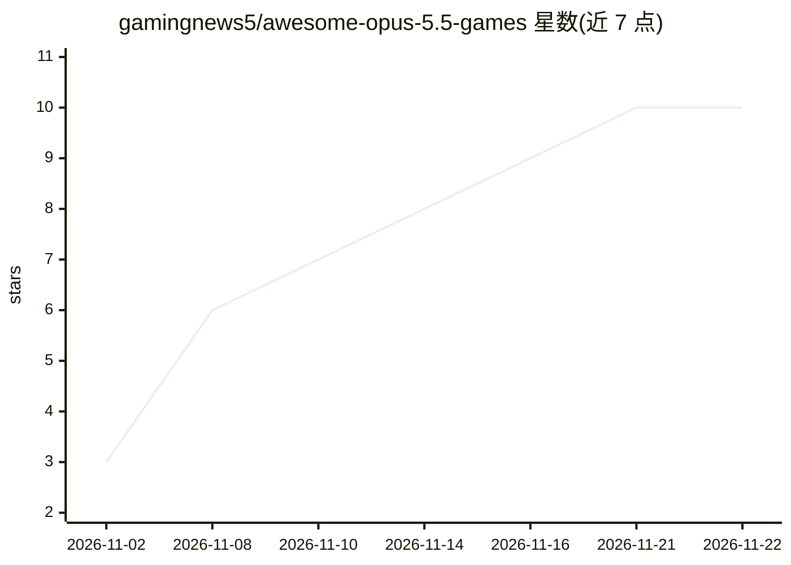

# gamingnews5/awesome-opus-5.5-games

⭐ 10 · Python · 推送 2026-10-27 · [GitHub](https://github.com/gamingnews5/awesome-opus-5.5-games) · [官网](https://games.omgithub.com/) · 个人维护

**AI 生成游戏来源清单：3888 个游戏条目按模型与评分浏览**

面向 AI 生成游戏发现需求的策展清单：收录 3888 个游戏条目，对应 3581 个经来源验证的 GitHub 仓库，逐条标注生成模型、证据等级与验证日期，并提供各游戏页面的截图评分与评分理由说明。内容按生成模型（Claude/GPT/Gemini 系列）分页浏览，附截图人工评审排名与按日更新的新仓库列表；提交入口要求提供可验证的来源仓库。以 Markdown 页面形式组织，无安装与运行环节。

## 筛选速览

| 维度 | 判定 | 备注 |
|---|---|---|
| AI 角色 | `ai-knowledge` | 知识聚合/清单类 |
| 许可风险 | `none` | — |
| 部署形态 | `None` |  |
| 模型依赖 | — | README 未给出锁定关系 |
| 硬件要求 | — | 无带数字的原话,不猜 |
| 安装摩擦 | `low` | 无编译、无系统依赖或容器化 |
| 成熟度 | — | 结构信号不足 |

## 能力要点

- 3888 个游戏条目均映射到经验证的 GitHub 源仓库
- 每条目可见模型证据等级与验证日期
- 截图评分排名附评分方法与理由说明
- 按生成模型分页浏览并区分具体版本标签

## 适用场景

- 浏览和发现 AI 生成的网页游戏
- 按生成模型筛选特定模型产出的游戏
- 查找某个 AI 游戏对应的源代码仓库

## 场景标签

`精选清单` · 领域:学习与行业

## 证据(README 行号)

> L3: Awesome AI Games: a curated field guide to AI-made games
> L5: ### 3888 curated game units. 3581 qualifying source repositories.
> L12: > Every listed unit maps to a qualifying GitHub source repository. The model-evidence grade is visible on every ent

## 星数曲线

2026-11-02 3 → 2026-11-22 10（+7）

---
*卡片 v1 · prompt 1.4 · 生成 2026-11-20 · 置信度 high · 依据 README sha `beae8d29b41a` · [字段定义](../../DATASET.md)*
