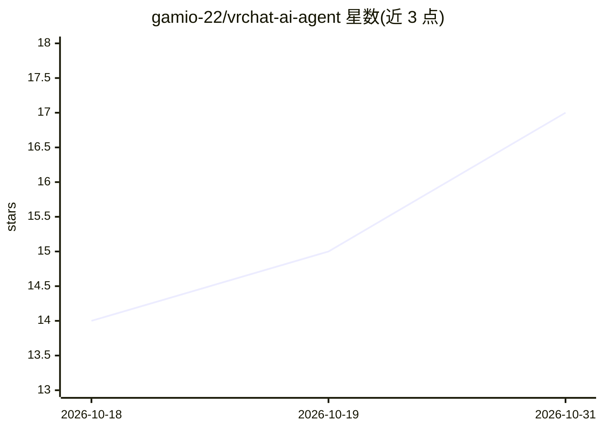

# gamio-22/vrchat-ai-agent

⭐ 17 · 推送 2026-09-25 · [GitHub](https://github.com/gamio-22/vrchat-ai-agent) · [官网](https://www.youtube.com/channel/UCXj9c0VsTbFLUMKkNMEHiDg) · 个人维护

**VRChat 上的自律 AI 伴侣 Agent：语音对话+视觉+记忆+情感驱动身体动作**

个人开发者在 VRChat 中运行的 AI 代理技术介绍项目：组合流式语音识别、本地 LLM 与云端 API 路由、VOICEVOX 系本地 TTS、YOLO/Pose 检测、VLM 视觉理解、ChromaDB/SQLite 长期记忆、情感/欲求内部状态与 VRChat OSC，实现对话、表情、移动、Use/Grab、钢琴与马拉卡斯演奏等身体行为。注意：代码、API key、人格数据与模型均不公开，不提供安装步骤与一般用途支持，仅为设计与验证记录。

## 筛选速览

| 维度 | 判定 | 备注 |
|---|---|---|
| AI 角色 | `ai-native` | 本体是模型或模型工具 |
| 许可风险 | `none` | — |
| 部署形态 | `None` |  |
| 模型依赖 | — | README 未给出锁定关系 |
| 硬件要求 | — | 无带数字的原话,不猜 |
| 安装摩擦 | `low` | 无编译、无系统依赖或容器化 |
| 成熟度 | `idea` | |

## 能力要点

- 语音识别→LLM/TTS 会话链路，本地与 API 双模式模型路由
- 视觉链路：人物/姿态检测、自定义物体检测、单目深度推定、VLM 描述（外部优先+本地回退）
- 三层（生发话/主张/情节）SQLite 记忆 + ChromaDB 向量检索，记忆可溯源引述
- 情感/欲求状态影响语气、TTS 声学参数与自主行为选择

## 适用场景

- 在 VRChat 中与具备视觉与身体动作的 AI 角色对话
- 参考其设计文档了解语音+视觉+记忆+OSC 的 Agent 架构
- 观察自律行为与情感模型在虚拟形象上的实现思路

## 场景标签

`语音 Agent` `多模态` · 领域:对话与助手

## 证据(README 行号)

> L40: VRChat上で動作する、音声会話・視覚認識・長期記憶・感情/欲求モデル・自律行動・OSCによる身体制御を組み合わせたAIエージェントです。
> L42: ユーザーの声を聞き、周囲をカメラで認識し、起動モードに応じてローカル会話レーンとクラウドAPIルートを切り替えながら返答を生成し、ローカルTTSエンジン（互換API）とVRChat Chatboxで応答します。視界説明やWeb検索

## 星数曲线

2026-10-18 14 → 2026-10-31 17（+3）

---
*卡片 v1 · prompt 1.4 · 生成 2026-10-30 · 置信度 high · 依据 README sha `db24202e0daa` · [字段定义](../../DATASET.md)*
