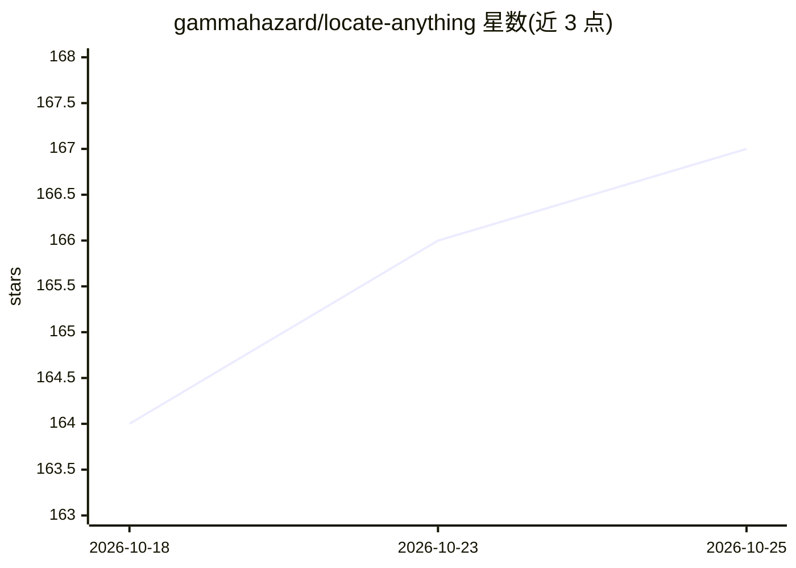

# gammahazard/locate-anything

⭐ 167 · TypeScript · Apache-2.0 · 推送 2026-09-10 · [GitHub](https://github.com/gammahazard/locate-anything) · 个人维护

**NVIDIA LocateAnything-3B 的网页 UI：自然语言查图并返回检测框**

为 NVIDIA LocateAnything-3B 模型提供移动端友好的 Web 界面：上传或拍摄图像，输入自然语言提示，获得边界框结果，覆盖目标检测、短语定位、OCR/文本定位、文档布局、GUI 元素定位与指向六类任务，并提供 fast/hybrid/slow 三档解码模式与可回放搜索历史。通过 docker compose 一键在自有 NVIDIA GPU（Ampere 及以上，建议 12GB+ 显存）上运行，支持远程 GPU 接入与无 GPU 的 mock 模式。模型许可为非商业（学术/研究用途），UI 代码为 Apache-2.0。

## 筛选速览

| 维度 | 判定 | 备注 |
|---|---|---|
| AI 角色 | `ai-native` | 本体是模型或模型工具 |
| 许可风险 | `permissive` | Apache-2.0 |
| 部署形态 | `desktop` | 安装包/桌面程序 |
| 模型依赖 | — | README 未给出锁定关系 |
| 硬件要求 | — | 无带数字的原话,不猜 |
| 安装摩擦 | `low` | 无编译、无系统依赖或容器化 |
| 成熟度 | — | 结构信号不足 |

## 能力要点

- 单提示框覆盖检测、grounding、OCR、文档布局、GUI 定位与指向六类任务
- docker compose 一键部署，首次运行自动下载约 6GB 模型
- 移动端优先设计，支持手机相机与远程 GPU 后端配置
- 提供无 GPU 的 mock 模式与 GPU 预检脚本

## 适用场景

- 在自有 GPU 上用自然语言查找图中目标并获取边界框
- 用手机拍摄并定位图像或文档中的文字与元素
- 无本地 GPU 时连接远程 Linux GPU 机器使用界面

## 场景标签

`目标检测` `OCR` · 领域:感知与多模态

## 证据(README 行号)

> L3: A sleek, mobile-friendly web UI for **NVIDIA LocateAnything-3B** — point it at an image, type what you want to find 
> L5: Run it on your own NVIDIA GPU with a single `docker compose up`.

## 星数曲线

2026-10-18 164 → 2026-10-25 167（+3）

---
*卡片 v1 · prompt 1.4 · 生成 2026-10-22 · 置信度 high · 依据 README sha `610452a99910` · [字段定义](../../DATASET.md)*
