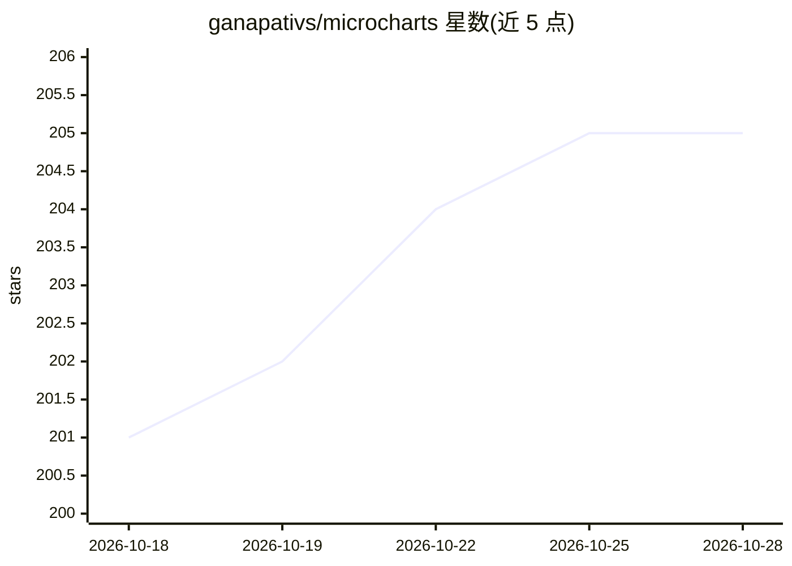

# ganapativs/microcharts

⭐ 205 · TypeScript · MIT · 推送 2026-10-27 · [GitHub](https://github.com/ganapativs/microcharts) · [官网](https://microcharts.dev) · 个人维护

**面向 LLM 输出场景的 React 微型图表库：106 种字内图表**

零运行时依赖的 React 图表库，提供 106 种微型图表（sparkline、bar、bullet 等），单个图表 gzip 约 1–7 kB，静态版本在 React Server Component 中渲染为零客户端 JavaScript 的纯 SVG。设计面向 LLM 场景：统一语法供模型在聊天回复中直接生成图表，每个图表自动生成基于数据的自然语言无障碍摘要；文档站点发布 llms.txt、catalog.json 等机器可读面，并附带 MCP 服务器供 Claude Desktop、Cursor 等助手调用查找与渲染图表。兼容 React 18/19，ESM-only，MIT 许可。

## 筛选速览

| 维度 | 判定 | 备注 |
|---|---|---|
| AI 角色 | `ai-ecosystem` | LLM/agent 周边工具 |
| 许可风险 | `permissive` | MIT |
| 部署形态 | `library` | 以包/库形式分发 |
| 模型依赖 | — | README 未给出锁定关系 |
| 硬件要求 | — | 无带数字的原话,不猜 |
| 安装摩擦 | `low` | 无编译、无系统依赖或容器化 |
| 成熟度 | `idea` | |

## 能力要点

- 106 种图表类型，零运行时依赖，静态图表零客户端 JavaScript（RSC-safe）
- 每图表自动生成自然语言无障碍摘要，随数据更新
- 附 MCP 服务器：find/get/render 三个工具，可渲染自包含 SVG 并附替代文本
- 提供 llms.txt、catalog.json 等面向模型的机器可读文档面

## 适用场景

- 在 AI 聊天回复、表格单元格、KPI 卡片中内联展示微型图表
- 让 Claude/Cursor 等助手通过 MCP 直接查找并渲染图表
- 在 React Server Component 中以零客户端 JS 渲染可访问图表

## 场景标签

 · 领域:前端/数据可视化

## 证据(README 行号)

> L21: card, a tab header, a streamed AI reply. The grammar is small enough for a model to emit correctly mid-sentence, an
> L157: The surfaces above are for reading. `@microcharts/mcp` lets an
> L158: assistant call the library directly: a Model Context Protocol server that runs on your machine over stdio, with th

## 星数曲线

2026-10-18 201 → 2026-10-28 205（+4）

---
*卡片 v1 · prompt 1.4 · 生成 2026-10-22 · 置信度 high · 依据 README sha `0451cd977c8c` · [字段定义](../../DATASET.md)*
