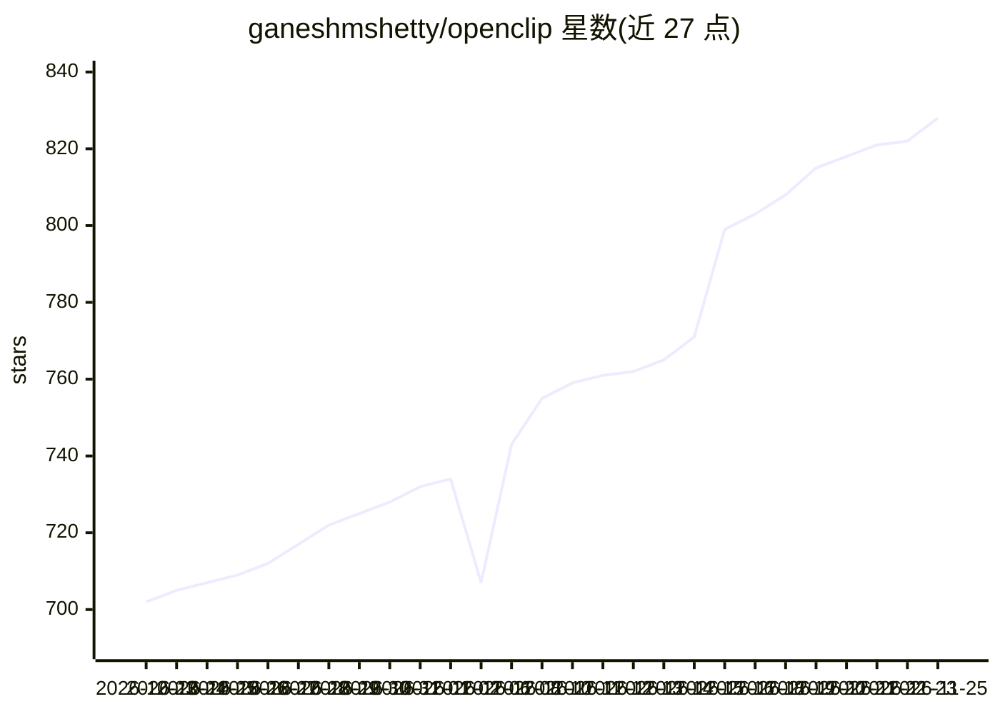

# ganeshmshetty/openclip

⭐ 828 · Swift · AGPL-3.0 · 推送 2026-11-23 · [GitHub](https://github.com/ganeshmshetty/openclip) · [官网](https://getopenclip.app) · 个人维护

**macOS 选中文本弹窗工具，支持脚本与 AI 动作**

面向 macOS 用户的文本动作弹窗：在任意应用中选中文本后弹出上下文操作栏，可转换大小写、搜索、复制/剪切、计算数学表达式、运行 shell 脚本、触发 Shortcuts，或调用 AI 模型处理文本。扩展以 `~/.openclip/extensions/` 文件夹形式编写，支持 JavaScript、Shell、AppleScript 与 URL scheme，并提供内置 Extension Store 安装社区扩展。AI 动作为可选功能，走本地 Ollama、Apple Intelligence 或自备的 OpenAI/Anthropic key。安装方式为 Homebrew cask、.dmg 下载或从源码构建（需 Xcode 16+ 与 XcodeGen），采用 AGPL-3.0 许可，声明零遥测。

## 筛选速览

| 维度 | 判定 | 备注 |
|---|---|---|
| AI 角色 | `ai-enhanced` | 去掉 AI 部分产品仍成立 |
| 许可风险 | `viral` | AGPL-3.0 |
| 部署形态 | `desktop` | 安装包/桌面程序 |
| 模型依赖 | local-ok | 支持本地模型 |
| 硬件要求 | — | 无带数字的原话,不猜 |
| 安装摩擦 | `low` | 无编译、无系统依赖或容器化 |
| 成熟度 | — | 结构信号不足 |

## 能力要点

- 选中文本弹出上下文操作栏，支持脚本/数学/快捷指令
- 扩展支持 JavaScript、Shell、AppleScript、URL scheme，带 Extension Store
- 可选 AI 动作：本地 Ollama、Apple Intelligence、OpenAI/Anthropic
- Swift 6 编写，声明零遥测、100% 本地执行

## 适用场景

- 选中文本后一键执行自定义脚本或文本变换
- 用本地 Ollama 模型对选中文本做 AI 处理
- 通过快捷键模糊搜索并触发整套动作目录

## 场景标签

 · 领域:开发者工具/效率工具

## 证据(README 行号)

> L3:  The open-source text action popup for macOS.
> L16: Select text in any app, and OpenClip pops up with contextual actions — transform text, run shell scripts, trigger s
> L36: - **Optional AI actions**: Run text through local Ollama models, Apple Intelligence, or OpenAI/Anthropic keys.

## 星数曲线

2026-10-23 702 → 2026-11-25 828（+126）

---
*卡片 v1 · prompt 1.4 · 生成 2026-11-24 · 置信度 high · 依据 README sha `1a08029757ca` · [字段定义](../../DATASET.md)*
