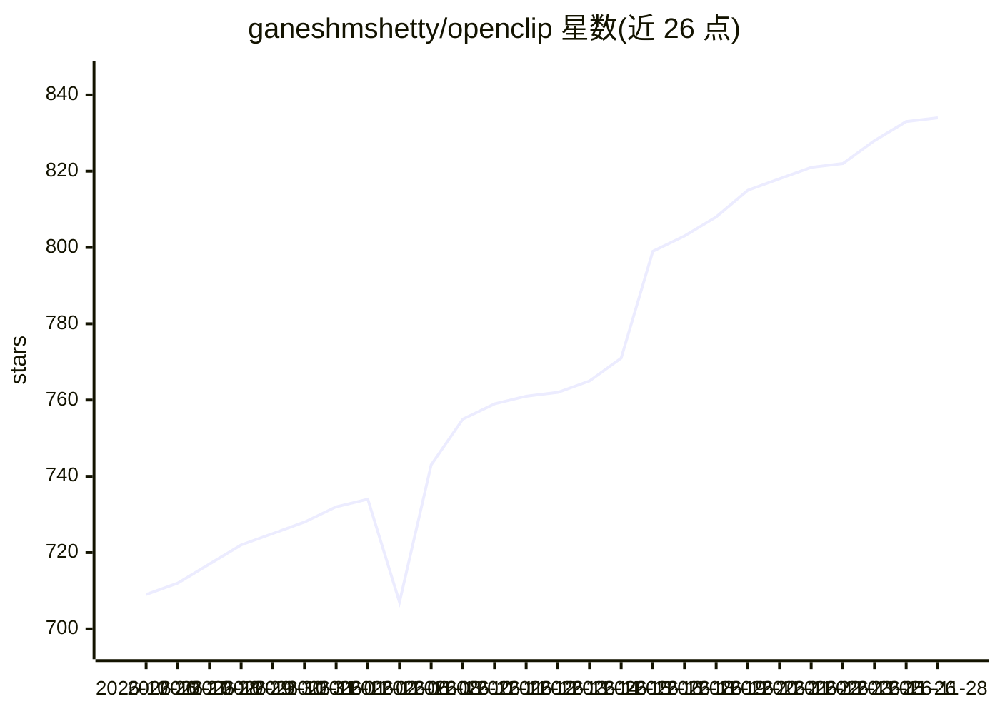

# ganeshmshetty/openclip

⭐ 834 · Swift · AGPL-3.0 · 推送 2026-11-27 · [GitHub](https://github.com/ganeshmshetty/openclip) · [官网](https://getopenclip.app) · 个人维护

**macOS 划词动作弹窗：对选中文本运行脚本与 AI 操作**

面向 macOS 14+ 的开源划词工具：在任意应用中选中文本后弹出上下文操作栏，支持大小写转换、搜索、复制剪切、数学求值、自定义脚本、快捷指令以及调用 AI 模型。扩展以文件夹形式放在 ~/.openclip/extensions/，用 JSON 清单定义，可用 JavaScript、Shell、AppleScript 或 URL scheme 编写，并通过内置 Extension Store 安装社区扩展。AI 操作为可选项，支持本地 Ollama、Apple Intelligence 或 OpenAI/Anthropic API key。默认无遥测、本地执行。

## 筛选速览

| 维度 | 判定 | 备注 |
|---|---|---|
| AI 角色 | `ai-enhanced` | 去掉 AI 部分产品仍成立 |
| 许可风险 | `viral` | AGPL-3.0 |
| 部署形态 | `desktop` | 安装包/桌面程序 |
| 模型依赖 | local-ok | 支持本地模型 |
| 硬件要求 | — | 无带数字的原话,不猜 |
| 安装摩擦 | `low` | 无编译、无系统依赖或容器化 |
| 成熟度 | — | 结构信号不足 |

## 能力要点

- 划词弹出上下文操作栏，含搜索面板（⌥⌘C 模糊搜索动作目录）
- 扩展系统支持 JavaScript/Shell/AppleScript/URL scheme，带 Extension Store
- 可选 AI 操作：本地 Ollama、Apple Intelligence 或 OpenAI/Anthropic key
- Swift 6 编写，零遥测，100% 本地执行

## 适用场景

- 对选中文本快速执行大小写转换、数学求值等操作
- 调用本地 Ollama 模型处理选中文本
- 编写自定义扩展接入自己的脚本工作流

## 场景标签

`AI 助手` · 领域:对话与助手

## 证据(README 行号)

> L16: Select text in any app, and OpenClip pops up with contextual actions — transform text, run shell scripts, trigger s
> L36: - **Optional AI actions**: Run text through local Ollama models, Apple Intelligence, or OpenAI/Anthropic keys.

## 星数曲线

2026-10-26 709 → 2026-11-28 834（+125）

---
*卡片 v1 · prompt 1.4 · 生成 2026-11-26 · 置信度 high · 依据 README sha `e444b021423e` · [字段定义](../../DATASET.md)*
