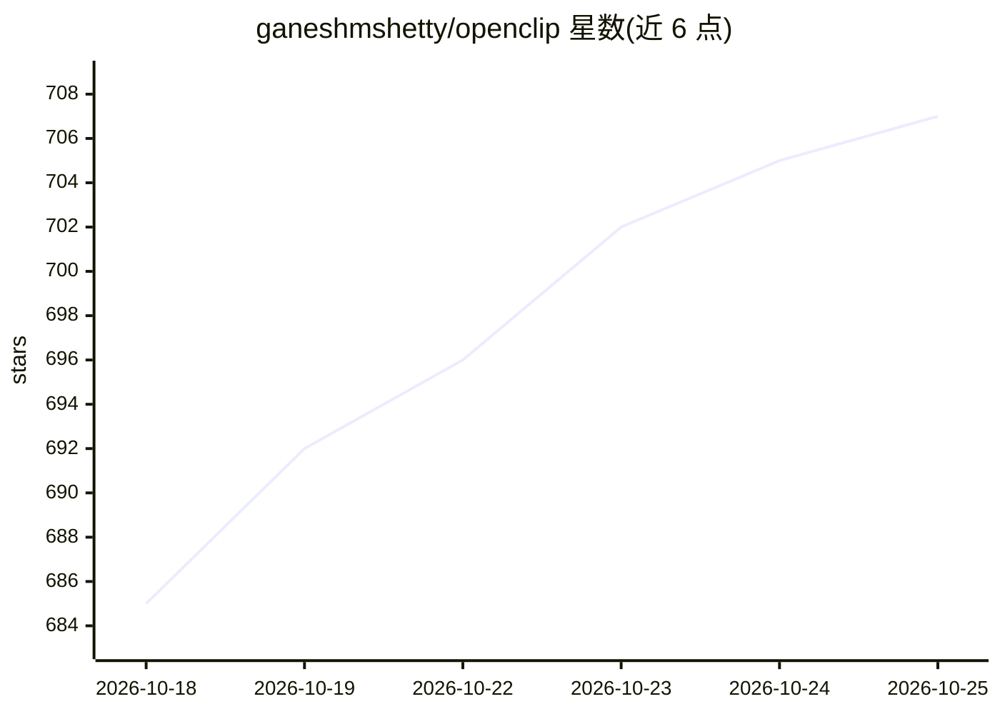

# ganeshmshetty/openclip

⭐ 707 · Swift · AGPL-3.0 · 推送 2026-10-24 · [GitHub](https://github.com/ganeshmshetty/openclip) · [官网](https://getopenclip.app) · 个人维护

**macOS 选中文本动作弹窗工具，可运行脚本与 AI 动作**

面向 macOS 用户的文本操作弹出工具：在任意应用中选中文本后弹出上下文动作条，支持大小写转换、搜索、数学表达式求值、触发快捷指令与自定义脚本，扩展可用 JavaScript、Shell、AppleScript 或 URL scheme 编写。AI 动作为可选功能，可调用本地 Ollama 模型、Apple Intelligence 或 OpenAI/Anthropic API key。零遥测，本地执行。需 macOS 14+ 与辅助功能权限，通过 Homebrew cask 或 dmg 安装，也可用 XcodeGen 从源码构建。

## 筛选速览

| 维度 | 判定 | 备注 |
|---|---|---|
| AI 角色 | `ai-enhanced` | 去掉 AI 部分产品仍成立 |
| 许可风险 | `viral` | AGPL-3.0 |
| 部署形态 | `desktop` | 安装包/桌面程序 |
| 模型依赖 | local-ok | 支持本地模型 |
| 硬件要求 | — | 无带数字的原话,不猜 |
| 安装摩擦 | `low` | 无编译、无系统依赖或容器化 |
| 成熟度 | — | 结构信号不足 |

## 能力要点

- 选中文本即弹出的上下文动作条（转换/搜索/数学/自定义脚本）
- 扩展支持 JavaScript、Shell、AppleScript、URL scheme
- 可选 AI 动作：本地 Ollama、Apple Intelligence、OpenAI/Anthropic key
- 零遥测、100% 本地执行

## 适用场景

- 在任意应用中选中文本快速执行转换或搜索动作
- 用自定义扩展把常用文本处理流程做成一键动作
- 通过本地或云端模型对选中文本运行 AI 动作

## 场景标签

 · 领域:macOS 桌面效率工具

## 证据(README 行号)

> L16: Select text in any app, and OpenClip pops up with contextual actions — transform text, run shell scripts, trigger s
> L32: - **Contextual bar** — Appears instantly near your selection with relevant actions (case transform, search, copy/cu
> L36: - **Optional AI actions** — Run text through local Ollama models, Apple Intelligence, or OpenAI/Anthropic keys.

## 星数曲线

2026-10-18 685 → 2026-10-25 707（+22）

---
*卡片 v1 · prompt 1.4 · 生成 2026-10-21 · 置信度 high · 依据 README sha `dd9cca0f2657` · [字段定义](../../DATASET.md)*
