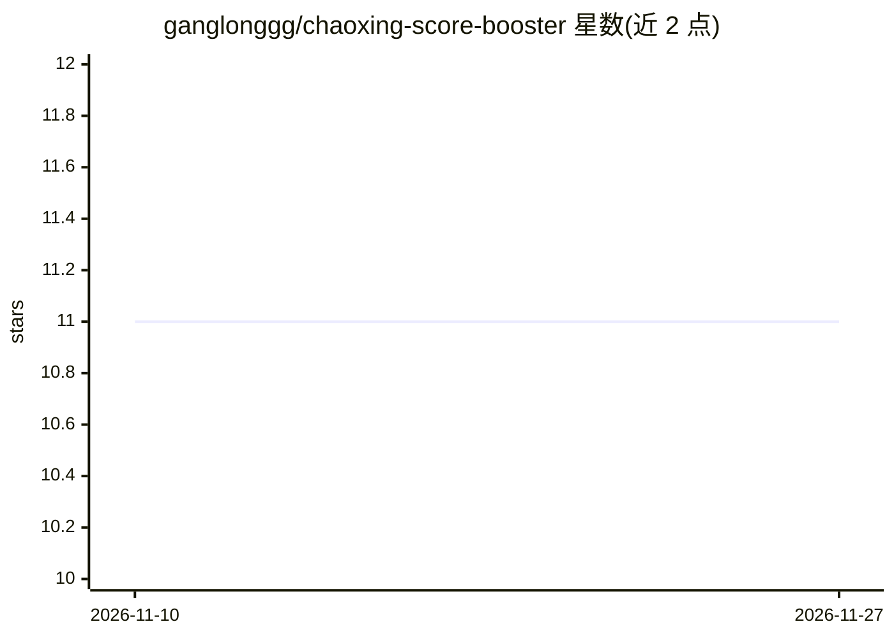

# ganglonggg/chaoxing-score-booster

⭐ 11 · JavaScript · MIT · 推送 2026-11-10 · [GitHub](https://github.com/ganglonggg/chaoxing-score-booster) · 个人维护 · 中文 README

**面向 Agent 的超星学习广场章节自测自动化技能**

以 Agent Skill 形式发布的自动化套件：通过 Chrome DevTools Protocol 驱动独立 Chrome 窗口，在超星学习广场定位章节测验，截取题目渲染快照供多模态 Agent 识图作答，提交并核对累计积分至目标值。基于 Node.js 22+ 原生标准库，无第三方 npm 依赖，提供 init/next-quiz/step 等 CLI 工具链与 SKILL.md 提示词规范，运行需本机已装 Chrome 与 Node.js。

## 筛选速览

| 维度 | 判定 | 备注 |
|---|---|---|
| AI 角色 | `ai-native` | 本体是模型或模型工具 |
| 许可风险 | `permissive` | MIT |
| 部署形态 | `library` | 以包/库形式分发 |
| 模型依赖 | — | README 未给出锁定关系 |
| 硬件要求 | — | 无带数字的原话,不猜 |
| 安装摩擦 | `low` | 无编译、无系统依赖或容器化 |
| 成熟度 | — | 结构信号不足 |

## 能力要点

- 基于 Chrome DevTools Protocol 截取题目快照，规避 base64 混淆字体
- Node.js 22+ 原生标准库实现，零第三方 npm 依赖
- 独立 --state-dir 隔离账号配置，与个人浏览器互不干扰
- 标准 CLI 工具链与 SKILL.md 规范，兼容多类 Agent

## 适用场景

- 自动化完成超星通识课章节自测并积累积分
- 在支持 Shell 与识图的 Agent 中挂载该技能使用
- 跨设备切换账号运行同一自动化流程

## 场景标签

`浏览器自动化` · 领域:效率与自动化

## 证据(README 行号)

> L3: 一个独立且通用的 AI Agent Skill：在 `tsjy.chaoxing.com` 超星学习广场（形势与政策/通识课），自动启动独立 Google Chrome 窗口，自适应新电脑、新 Agent 与新账号，定位章节测验并利
> L11:  - 包含完整的 SKILL.md 提示词规范与标准化 CLI 工具链（`init` / `next-quiz` / `step` / `status` / `finish`）。
> L55: - **Agent 能力**：支持执行本地 Shell 命令、具备多模态识图能力（如查看图片文件）

## 星数曲线

2026-11-10 11 → 2026-11-27 11（+0）

---
*卡片 v1 · prompt 1.4 · 生成 2026-11-18 · 置信度 mid · 依据 README sha `9182e3be5445` · [字段定义](../../DATASET.md)*
