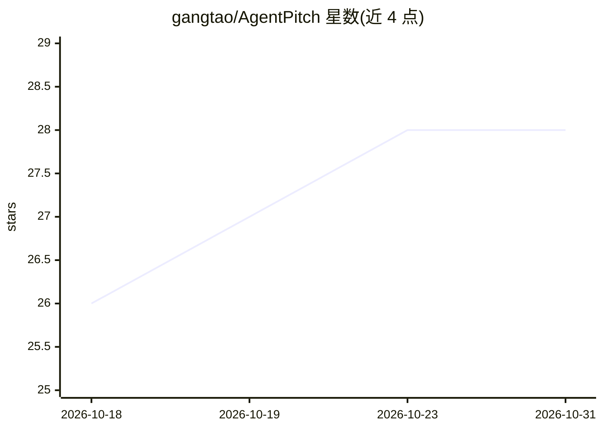

# gangtao/AgentPitch

⭐ 28 · HTML · Apache-2.0 · 推送 2026-08-01 · [GitHub](https://github.com/gangtao/AgentPitch) · [官网](https://gangtao.github.io/AgentPitch/) · 个人维护

**LLM 驱动的足球模拟：每个球员是 AI agent，策略随比赛进化**

面向开发者的足球比赛模拟系统：每位球员由 decide() 回调决定行为，回调代码可由 LLM 生成（Python/JavaScript/Rust，在 RestrictedPython/QuickJS/Wasmtime 沙箱中执行，无宿主机访问）。赛前 Code Generation Pipeline 让 LLM 生成策略，赛后 Post-Match Evolution Pipeline 将比赛日志回喂 LLM 使策略迭代。提供浏览器实时比赛视图、比赛回放单文件 HTML、杯赛与联赛赛制。支持 OpenAI/Anthropic/Gemini/DeepSeek/OpenRouter/Ollama 作为 LLM 提供方，API key 仅存本地。提供 CLI 与 Docker 运行方式。

## 筛选速览

| 维度 | 判定 | 备注 |
|---|---|---|
| AI 角色 | `ai-native` | 本体是模型或模型工具 |
| 许可风险 | `permissive` | Apache-2.0 |
| 部署形态 | `self-host` | docker 或自建部署 |
| 模型依赖 | local-ok | 支持本地模型 |
| 硬件要求 | — | 无带数字的原话,不猜 |
| 安装摩擦 | `low` | 无编译、无系统依赖或容器化 |
| 成熟度 | — | 结构信号不足 |

## 能力要点

- LLM 生成并进化球员策略代码，赛后日志反馈迭代
- Python/JS/Rust 三语言沙箱执行（RestrictedPython/QuickJs/Wasmtime）
- 杯赛、联赛与对战竞技场模式，浏览器实时视图与事件流
- 支持 6 种 LLM 提供方含本地 Ollama，key 仅本地存储

## 适用场景

- 用 LLM 生成并进化球队策略进行模拟比赛
- 举办单败淘汰杯赛或循环联赛观察策略对抗
- 回放并分享比赛（单文件 HTML，无需服务器）

## 场景标签

`多智能体` · 领域:Agent 开发

## 证据(README 行号)

> L8: An LLM-powered soccer simulation where every player on the field is an AI agent. Each player's decision logic is gen
> L26: Each player runs a `decide(game_state, player_state, history)` callback that you or an LLM writes in Python, JavaSc

## 星数曲线

2026-10-18 26 → 2026-10-31 28（+2）

---
*卡片 v1 · prompt 1.4 · 生成 2026-10-26 · 置信度 high · 依据 README sha `783f71f3af6a` · [字段定义](../../DATASET.md)*
