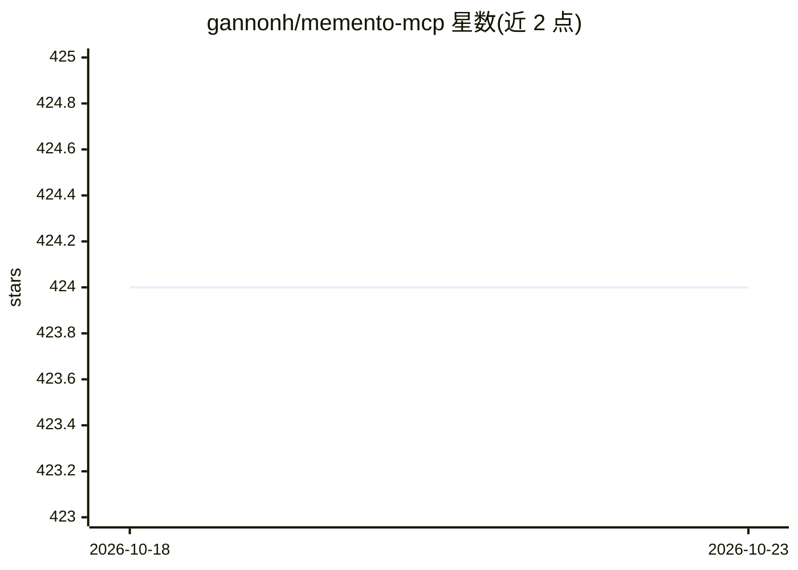

# gannonh/memento-mcp

⭐ 424 · TypeScript · MIT · 推送 2025-10-27 · [GitHub](https://github.com/gannonh/memento-mcp) · 个人维护

**为 LLM 客户端提供 Neo4j 知识图谱长期记忆的 MCP 服务器**

基于 Model Context Protocol 的记忆服务器，向 Claude Desktop、Cursor、GitHub Copilot 等 LLM 客户端提供持久化知识图谱记忆。以 Neo4j（5.13+）为统一存储后端，同时承担图存储与向量检索；实体自动生成 OpenAI 嵌入向量，支持语义/关键词/混合搜索。关系与实体带完整版本历史、时间点查询、置信度衰减（默认 30 天半衰期）与富元数据。通过 MCP 工具接口暴露实体/关系增删改查、语义搜索等操作。需自行部署 Neo4j，支持 Neo4j Desktop 或 Docker Compose 方式运行。

## 筛选速览

| 维度 | 判定 | 备注 |
|---|---|---|
| AI 角色 | `ai-ecosystem` | LLM/agent 周边工具 |
| 许可风险 | `permissive` | MIT |
| 部署形态 | `self-host` | docker 或自建部署 |
| 模型依赖 | — | README 未给出锁定关系 |
| 硬件要求 | — | 无带数字的原话,不猜 |
| 安装摩擦 | `low` | 无编译、无系统依赖或容器化 |
| 成熟度 | — | 结构信号不足 |

## 能力要点

- Neo4j 统一图存储与向量检索后端
- 实体向量嵌入与语义/关键词/混合自适应搜索
- 实体与关系的完整版本历史与时间点查询
- 关系置信度时间衰减（可配置半衰期）与强化恢复

## 适用场景

- 为 Claude Desktop / Cursor 等 MCP 客户端接入长期知识记忆
- 跨会话保留和检索结构化的实体关系知识
- 追溯知识图谱中信息随时间的演变历史

## 场景标签

`Agent 记忆` `知识图谱` · 领域:Agent 开发

## 证据(README 行号)

> L5: Scalable, high performance knowledge graph memory system with semantic retrieval, contextual recall, and temporal aw
> L53: Memento MCP uses Neo4j as its storage backend, providing a unified solution for both graph storage and vector searc
> L235: The following tools are available to LLM client hosts through the Model Context Protocol:

## 星数曲线

2026-10-18 424 → 2026-10-23 424（+0）

---
*卡片 v1 · prompt 1.4 · 生成 2026-10-22 · 置信度 mid · 依据 README sha `c5a634f9f7d1` · [字段定义](../../DATASET.md)*
