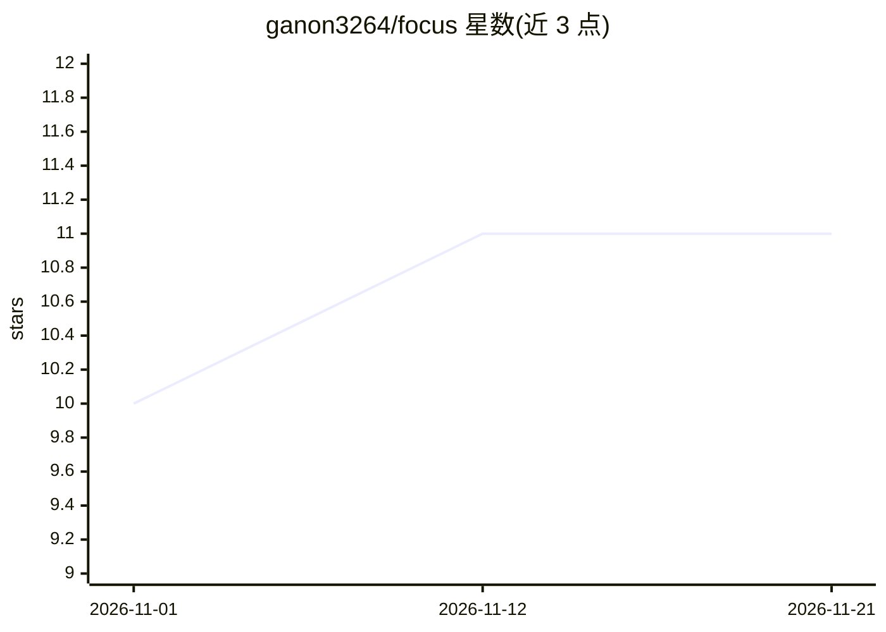

# ganon3264/focus

⭐ 11 · Python · MIT · 推送 2026-11-17 · [GitHub](https://github.com/ganon3264/focus) · 个人维护

**面向 LLM 角色扮演的自托管聊天前端**

以 FastAPI + HTMX 构建的 LLM 角色扮演前端，需 Python 3.13+，克隆仓库后通过启动脚本在本地浏览器运行。功能包括角色卡导入、预设管理、prompt 编排、采样器设置、多模态图片附件、基础工具调用与 reasoning_content 回传。支持接入 OAI 兼容 API 及 OpenRouter、DeepSeek、Moonshot 等多家服务商。可导入 SillyTavern 角色卡与预设，但有宏未实现的限制。

## 筛选速览

| 维度 | 判定 | 备注 |
|---|---|---|
| AI 角色 | `ai-native` | 本体是模型或模型工具 |
| 许可风险 | `permissive` | MIT |
| 部署形态 | `None` |  |
| 模型依赖 | locked-api |  |
| 硬件要求 | — | 无带数字的原话,不猜 |
| 安装摩擦 | `low` | 无编译、无系统依赖或容器化 |
| 成熟度 | — | 结构信号不足 |

## 能力要点

- 支持接入多种 LLM API（OpenRouter/DeepSeek/Moonshot/Google 等）
- 多模态支持：图片可附加到 prompt 块、角色卡与 persona
- 基础工具调用与 reasoning_content 预填/回传
- 支持导入 SillyTavern 角色卡与预设

## 适用场景

- 自托管一个本地运行的 LLM 角色扮演聊天界面
- 接入多家 LLM 服务商进行角色对话
- 从 SillyTavern 迁移角色卡与预设

## 场景标签

`聊天机器人` · 领域:对话与助手

## 证据(README 行号)

> L3:  A roleplaying thingy, kinda like SillyTavern, but opinionated and personal (and sloppy).
> L31: 2. Add/Import a character
> L54: - Multimodal support as first class citizen

## 星数曲线

2026-11-01 10 → 2026-11-21 11（+1）

---
*卡片 v1 · prompt 1.4 · 生成 2026-11-18 · 置信度 high · 依据 README sha `9071082d8a45` · [字段定义](../../DATASET.md)*
