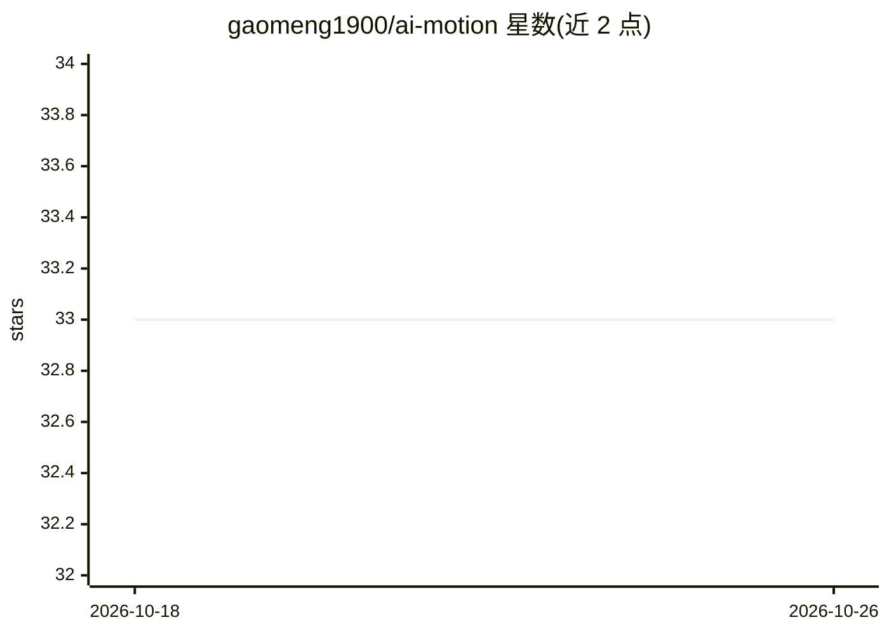

# gaomeng1900/ai-motion

⭐ 33 · TypeScript · MIT · 推送 2026-09-22 · [GitHub](https://github.com/gaomeng1900/ai-motion) · [官网](https://gaomeng1900.github.io/ai-motion/) · 个人维护 · 中文 README

**零依赖的 WebGL2 动画边框前端组件库**

基于 WebGL2 的网页动画边框渲染库，生成带渐变辉光效果的动画边框，支持 light/dark 两种模式（分别适配浅色与深色背景）、4 色渐变自定义、自动跟随元素尺寸（ResizeObserver）、淡入淡出动画与 30fps 帧率上限。零依赖，要求浏览器支持 WebGL2，不支持时构造抛出错误。以 npm 包形式分发，提供 start/pause/dispose/resize 等 API。

## 筛选速览

| 维度 | 判定 | 备注 |
|---|---|---|
| AI 角色 | `ai-enhanced` | 去掉 AI 部分产品仍成立 |
| 许可风险 | `permissive` | MIT |
| 部署形态 | `library` | 以包/库形式分发 |
| 模型依赖 | — | README 未给出锁定关系 |
| 硬件要求 | — | 无带数字的原话,不猜 |
| 安装摩擦 | `low` | 无编译、无系统依赖或容器化 |
| 成熟度 | — | 结构信号不足 |

## 能力要点

- WebGL2 渲染动画边框，零依赖
- light/dark 双模式与 4 色 RGB 渐变自定义
- autoResize 基于 ResizeObserver 自动适配元素尺寸
- fadeIn/fadeOut 过渡与 30fps 帧率上限

## 适用场景

- 给网页 Hero 区域或卡片加动画边框背景
- 响应式容器中自动适配尺寸的装饰性动画效果

## 场景标签

 · 领域:前端/Web 可视化

## 证据(README 行号)

> L10: WebGL2 animated border with AI-style glow effects. Zero dependencies, modern browsers only.
> L182: - WebGL2 support

## 星数曲线

2026-10-18 33 → 2026-10-26 33（+0）

---
*卡片 v1 · prompt 1.4 · 生成 2026-10-25 · 置信度 high · 依据 README sha `f9013d1ecaf2` · [字段定义](../../DATASET.md)*
