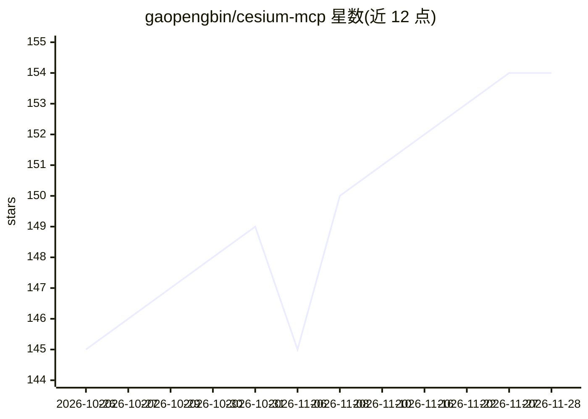

# gaopengbin/cesium-mcp

⭐ 154 · JavaScript · MIT · 推送 2026-11-27 · [GitHub](https://github.com/gaopengbin/cesium-mcp) · [官网](https://gaopengbin.github.io/cesium-mcp/) · 个人维护 · 中文 README

**让 AI Agent 通过 MCP/函数调用控制 CesiumJS 三维地图的运行时**

以协议无关的命令执行器（bridge）为核心，提供 60+ 个 CesiumJS 控制命令，分为 12 个工具集；通过四种路径接入：浏览器内 Agent、WebMCP 页面级工具、自建 Web 应用的函数调用、以及供 Claude Desktop/Cursor/Dify 等外部 MCP 宿主调用的 Runtime（stdio/HTTP）。共享 JSON Schema 契约统一工具描述，支持中英文 locale、工具集按需启用，含 hosted 演示与 Codex 地图插件。MIT 许可，npm 分发多个包。

## 筛选速览

| 维度 | 判定 | 备注 |
|---|---|---|
| AI 角色 | `ai-ecosystem` | LLM/agent 周边工具 |
| 许可风险 | `permissive` | MIT |
| 部署形态 | `library` | 以包/库形式分发 |
| 模型依赖 | — | README 未给出锁定关系 |
| 硬件要求 | — | 无带数字的原话,不猜 |
| 安装摩擦 | `low` | 无编译、无系统依赖或容器化 |
| 成熟度 | — | 结构信号不足 |

## 能力要点

- 协议无关的 bridge 执行器（60+ 命令），四种集成路径（Browser Agent/WebMCP/函数调用/MCP）
- 12 个工具集组织 62 个命令工具，支持运行时动态发现与激活
- 共享 JSON Schema 契约层，工具描述支持 CESIUM_LOCALE=zh-CN 中文化
- MCP Runtime 通过官方 server-stateless 一致性场景（28/28）

## 适用场景

- 在 Claude Desktop/Cursor/Dify 中通过对话控制三维地球场景
- 在自有 Web 应用中让 LLM 通过函数调用操作 CesiumJS 地图
- 用浏览器内 Agent 零后端快速搭建可对话的三维地图演示

## 场景标签

 · 领域:GIS/三维可视化与 AI Agent 集成

## 证据(README 行号)

> L23:  A protocol-agnostic Cesium AI control runtime for MCP, WebMCP, function calling, and browser agents
> L25:  cesium-mcp-bridge is the protocol-agnostic Cesium command executor. Separate adapters expose it to browser-only ag
> L94: |**cesium-mcp-runtime**|MCP server (stdio + HTTP)|Stable MCP SDK v2|npm · source|

## 星数曲线

2026-10-26 145 → 2026-11-28 154（+9）

---
*卡片 v1 · prompt 1.4 · 生成 2026-11-27 · 置信度 high · 依据 README sha `b329a68f2fab` · [字段定义](../../DATASET.md)*
