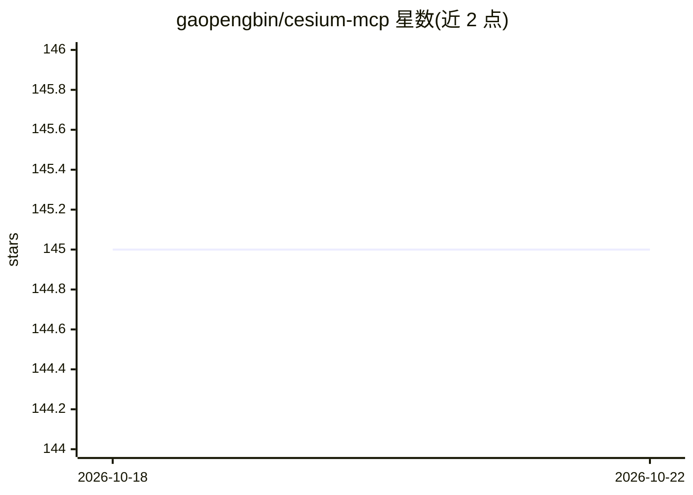

# gaopengbin/cesium-mcp

⭐ 145 · JavaScript · MIT · 推送 2026-10-21 · [GitHub](https://github.com/gaopengbin/cesium-mcp) · [官网](https://gaopengbin.github.io/cesium-mcp/) · 个人维护 · 中文 README

**给 AI agent 的 CesiumJS 三维地球控制运行时（MCP/WebMCP/函数调用）**

协议无关的 Cesium 地图 AI 控制运行时：核心是 cesium-mcp-bridge 命令执行器，提供 62 个工具（相机飞行、实体增删、图层加载、3D Tiles/高斯泼溅、热力图、轨迹等 12 个工具集），经四条接入路径暴露——浏览器 agent、WebMCP（document.modelContext）、应用内函数调用、MCP Runtime（stdio/HTTP，供 Claude Desktop/Cursor/Dify 调用）。作者曾参与 CesiumGS/cesium-ai-integrations 早期贡献，本项目实现独立。限制：Runtime 仅在外部 MCP 主机场景需要；WebMCP 需 Chrome 149+ 实验特性。

## 筛选速览

| 维度 | 判定 | 备注 |
|---|---|---|
| AI 角色 | `ai-ecosystem` | LLM/agent 周边工具 |
| 许可风险 | `permissive` | MIT |
| 部署形态 | `library` | 以包/库形式分发 |
| 模型依赖 | — | README 未给出锁定关系 |
| 硬件要求 | — | 无带数字的原话,不猜 |
| 安装摩擦 | `low` | 无编译、无系统依赖或容器化 |
| 成熟度 | `idea` | |

## 能力要点

- 62 个命令工具分 12 个工具集，默认启用 4 核心集 30 个工具
- 四条接入路径共用同一 Bridge 执行层（浏览器 agent/WebMCP/函数调用/MCP）
- MCP Runtime 通过官方 server-stateless 一致性场景（28/28）
- 内置 Viewer 与托管浏览器 demo，可免安装试用

## 适用场景

- 在 Claude Desktop/Cursor/Dify 中通过 MCP 操控三维地球场景
- 在自有 Web 应用中嵌入函数调用方式的 Cesium AI 工具
- 浏览器 agent 经 WebMCP 发现并执行页面内地图工具
- 用 AI 加载 GeoJSON/3D Tiles 并生成截图与热力图

## 场景标签

`Agent 框架` · 领域:Agent 开发

## 证据(README 行号)

> L23:  A protocol-agnostic Cesium AI control runtime for MCP, WebMCP, function calling, and browser agents
> L25:  cesium-mcp-bridge is the protocol-agnostic Cesium command executor. Separate adapters expose it to browser-only ag
> L27:  Four integration paths: Browser Agent (simplest, zero backend) · WebMCP (page-local browser tools) · function call

## 星数曲线

2026-10-18 145 → 2026-10-22 145（+0）

---
*卡片 v1 · prompt 1.4 · 生成 2026-10-22 · 置信度 high · 依据 README sha `1953a7d1e0ce` · [字段定义](../../DATASET.md)*
