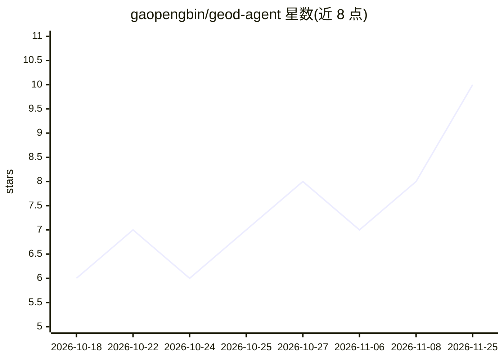

# gaopengbin/geod-agent

⭐ 10 · JavaScript · MIT · 推送 2026-11-18 · [GitHub](https://github.com/gaopengbin/geod-agent) · [官网](https://geod.laogao.xyz/agent) · 个人维护 · 中文 README

**给 GIS 用户：用 AI 对话下载与处理地理数据的 Windows 桌面应用**

独立的 Windows 桌面应用，通过对话描述数据需求，模型负责理解需求与组织工具调用，下载、拼接、裁剪与文件核验由用户本机完成。支持 XYZ/WMTS/ArcGIS 影像、DEM、历史影像、OSM 矢量与 3D Tiles 资源下载，内置 OpenLayers/Cesium 二三维地图。0.2.4 起将 Java、Tika、POI、OCR 等 GIS 原生依赖拆为五项按需安装的技能，包体使用 SHA-256 校验。支持 MCP、Skill 扩展与自有模型渠道；影像瓦片不经其模型服务器中转。

## 筛选速览

| 维度 | 判定 | 备注 |
|---|---|---|
| AI 角色 | `ai-enhanced` | 去掉 AI 部分产品仍成立 |
| 许可风险 | `permissive` | MIT |
| 部署形态 | `None` |  |
| 模型依赖 | — | README 未给出锁定关系 |
| 硬件要求 | — | 无带数字的原话,不猜 |
| 安装摩擦 | `low` | 无编译、无系统依赖或容器化 |
| 成熟度 | `idea` | |

## 能力要点

- 对话配置图源并组织任务，下载处理在本机完成
- 支持影像/DEM/历史影像/矢量/3D Tiles 五类数据工作流
- GIS 原生依赖拆分为五项按需安装技能，含离线组件目录
- 内置 OpenLayers/Cesium 工具，二维/三维切换与成果加载

## 适用场景

- 按行政边界或自绘范围批量下载影像并裁剪输出 GeoTIFF
- 下载 DEM 高程数据用于三维地形展示
- 通过 MCP 接入外部地图服务并组织下载任务
- 用定时任务周期性执行下载或 AI 指令模板

## 场景标签

`AI 助手` · 领域:对话与助手

## 证据(README 行号)

> L18: GeoD Agent 是独立的 Windows 桌面应用。描述区域、数据类型和用途，核对图源、范围与输出参数，由你的电脑完成下载、拼接、裁剪和文件核验。模型负责理解需求与组织工具调用；影像瓦片不经 GeoD 模型服务器中转。
> L70: |影像|XYZ / WMTS / ArcGIS ImageServer，注记合成，范围下载、拼接与裁剪|GeoTIFF、MBTiles、PNG / JPEG、GeoPackage、原始瓦片|
> L103: 基础安装包移除 Java、Tika、Apache POI 和本地 OCR，GIS 原生依赖拆成五项技能，已下载的依赖共享复用：

## 星数曲线

2026-10-18 6 → 2026-11-25 10（+4）

---
*卡片 v1 · prompt 1.4 · 生成 2026-11-24 · 置信度 mid · 依据 README sha `d4a1f03898a3` · [字段定义](../../DATASET.md)*
