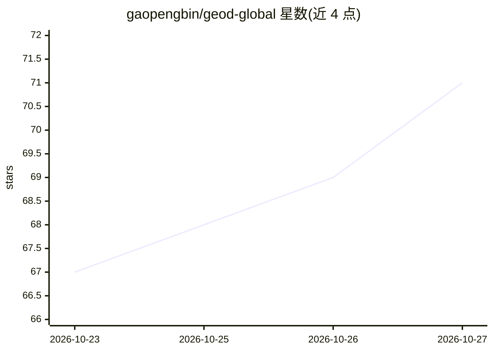

# gaopengbin/geod-global

⭐ 71 · Rust · GPL-3.0 · 推送 2026-10-26 · [GitHub](https://github.com/gaopengbin/geod-global) · [官网](https://geod-global.laogao.xyz) · 个人维护 · 中文 README

**Windows 桌面遥感与地理空间数据聚合下载工具**

面向 Windows 的地理空间数据工作区：聚合 17 大类、110 个可用数据条目（Sentinel/Landsat 影像、DEM、土地覆盖、气候、人口、矢量与地图服务等），支持按类型选源、区域检索、多选地图预览、下载与本地成果管理（出处、校验和、像元检视）。可自带模型（BYOK）连接为 Agent 模式，用自然语言准备检索与下载任务；本地使用无需 Global 账号。本版本仅覆盖 2D 数据，不含托管 AI、云同步与非 Windows 安装器。

## 筛选速览

| 维度 | 判定 | 备注 |
|---|---|---|
| AI 角色 | `ai-enhanced` | 去掉 AI 部分产品仍成立 |
| 许可风险 | `viral` | GPL-3.0 |
| 部署形态 | `None` |  |
| 模型依赖 | — | README 未给出锁定关系 |
| 硬件要求 | — | 无带数字的原话,不猜 |
| 安装摩擦 | `medium` | 含编译或系统依赖之一 |
| 成熟度 | — | 结构信号不足 |

## 能力要点

- 17 大类 110 个可用数据条目，含 STAC/COG/WMS/WMTS 等协议与本地格式
- 选源→检索→多选预览→下载→本地检视的完整链路，输出出处与校验和
- BYOK Agent：连接自有模型，经任务审核与持久任务执行检索下载
- 无需 Node/Rust/Python/系统 GDAL，仅要求 WebView2

## 适用场景

- 按区域检索并下载 Sentinel-2、Landsat 等卫星影像与 DEM
- 在一个工作区内管理土地覆盖、气候、人口等多源栅格与矢量数据
- 连接自己的模型，用对话准备数据检索与下载任务

## 场景标签

 · 领域:遥感/地理空间数据工具

## 证据(README 行号)

> L6: **遥感影像与地理空间数据下载工具**：聚合卫星影像、DEM 高程、土地覆盖、气候海洋、人口、矢量与地图服务；支持区域检索、多选地图预览、下载与本地成果管理。
> L17: Explore manually or connect your own model to prepare searches and download tasks with the Agent.
> L68: - **Bring your own model:** scoped native tools, task review and persistent jobs. Home conversations and Explore si

## 星数曲线

2026-10-23 67 → 2026-10-27 71（+4）

---
*卡片 v1 · prompt 1.4 · 生成 2026-10-24 · 置信度 high · 依据 README sha `b9efb58c67f4` · [字段定义](../../DATASET.md)*
