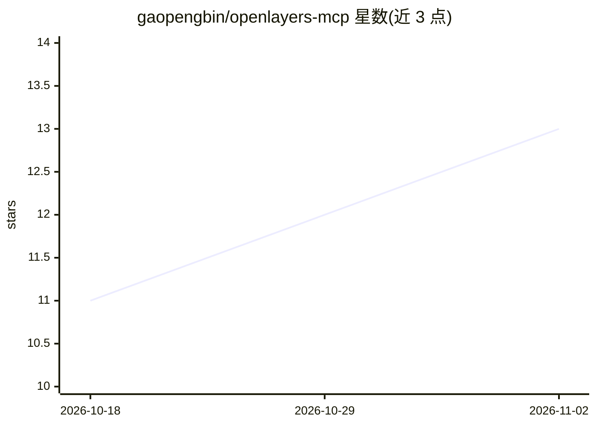

# gaopengbin/openlayers-mcp

⭐ 13 · TypeScript · MIT · 推送 2026-11-01 · [GitHub](https://github.com/gaopengbin/openlayers-mcp) · 个人维护 · 中文 README

**通过 MCP 让 AI Agent 用自然语言控制 OpenLayers 地图**

由 runtime（stdio MCP Server）与 bridge（浏览器 SDK）两个包组成：AI Agent 经 MCP 协议调用 runtime，runtime 通过 WebSocket JSON-RPC 将指令下发到浏览器端 bridge，由 bridge 操作 OpenLayers 地图。提供 view、layer、feature、interaction、overlay、style、draw 七个工具集共 30+ 工具，默认启用 4 个核心工具集，可用元工具动态启用其余。支持 Claude Desktop、Cursor 等 MCP 客户端接入，从源码 clone 构建后以 npx 启动。

## 筛选速览

| 维度 | 判定 | 备注 |
|---|---|---|
| AI 角色 | `ai-ecosystem` | LLM/agent 周边工具 |
| 许可风险 | `permissive` | MIT |
| 部署形态 | `library` | 以包/库形式分发 |
| 模型依赖 | — | README 未给出锁定关系 |
| 硬件要求 | — | 无带数字的原话,不猜 |
| 安装摩擦 | `low` | 无编译、无系统依赖或容器化 |
| 成熟度 | — | 结构信号不足 |

## 能力要点

- 30+ 地图工具分 7 个工具集，含飞行定位、图层管理、要素增删、截图等
- runtime（stdio MCP Server）+ 浏览器 bridge 经 WebSocket 通信的双包架构
- 默认启用 4 个核心工具集，可经 list_toolsets/enable_toolset 动态扩展
- 支持 EPSG:4326/3857 与自定义投影，兼容 GeoJSON/WMS/WFS 等格式

## 适用场景

- 在 Claude Desktop 或 Cursor 中用自然语言操作网页地图
- 让 AI 生成地图内容并导出为 GeoJSON
- 对 OpenLayers 地图进行截图与要素查询

## 场景标签

 · 领域:WebGIS/地图工具

## 证据(README 行号)

> L3:  AI-Powered Map Control via Model Context Protocol for OpenLayers
> L26: |openlayers-mcp-runtime|MCP Server (stdio) — 30+ tools across 7 toolsets, WebSocket bridge to browser|

## 星数曲线

2026-10-18 11 → 2026-11-02 13（+2）

---
*卡片 v1 · prompt 1.4 · 生成 2026-11-01 · 置信度 high · 依据 README sha `60adea755a46` · [字段定义](../../DATASET.md)*
