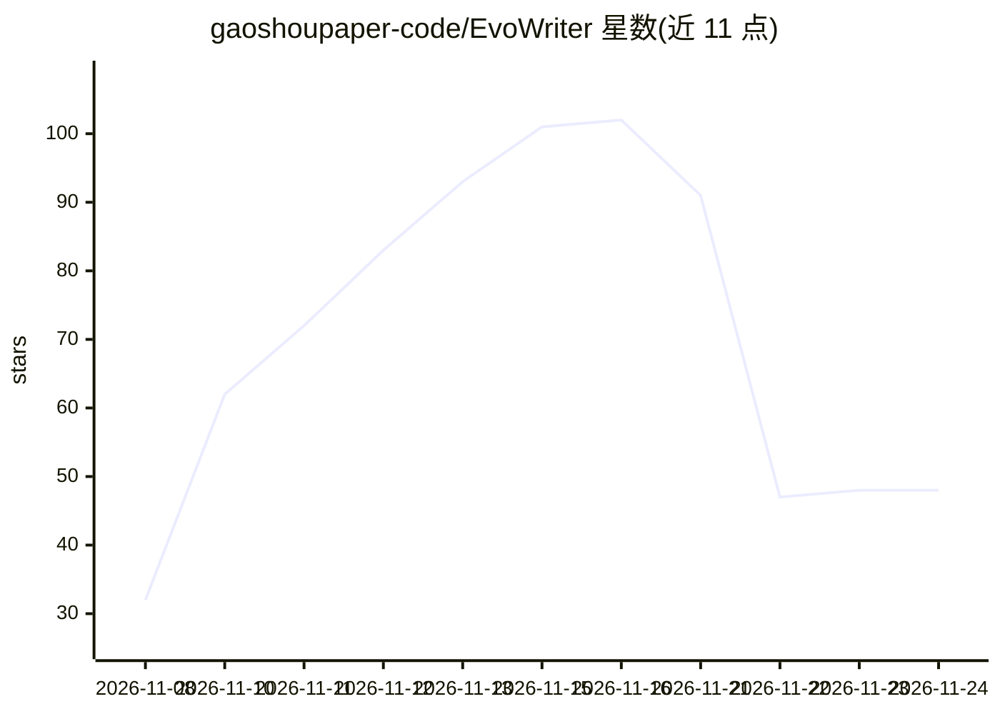

# gaoshoupaper-code/EvoWriter

⭐ 48 · Python · MIT · 推送 2026-11-22 · [GitHub](https://github.com/gaoshoupaper-code/EvoWriter) · 个人维护 · 中文 README

**自进化长篇小说创作多 Agent 平台，含观测与门禁发版闭环**

面向长篇小说创作的全流程 Agent 平台：创作 Agent 覆盖大纲到正文生成，生产运行沉淀 canonical trace，经评估（判评分离、28 维评分、契约矩阵）、人机共创改进外置为 git 版本化 harness 的 Agent 定义，再经门禁发版热加载回生产，形成自进化闭环。配套自研 trace 观测底座（增量存储、四维正交状态机、确定性制品恢复）、类型化叙事记忆（当前休眠）与 26 个洋葱中间件治理执行。全栈 Python + Tauri 2 桌面端，单人开发，README 未给出具体安装命令，细节文档在 docs/ 系统心智模型。

## 筛选速览

| 维度 | 判定 | 备注 |
|---|---|---|
| AI 角色 | `ai-native` | 本体是模型或模型工具 |
| 许可风险 | `permissive` | MIT |
| 部署形态 | `self-host` | docker 或自建部署 |
| 模型依赖 | — | README 未给出锁定关系 |
| 硬件要求 | — | 无带数字的原话,不猜 |
| 安装摩擦 | `low` | 无编译、无系统依赖或容器化 |
| 成熟度 | — | 结构信号不足 |

## 能力要点

- 自进化闭环：生产 trace → 评估 → 人机共创 → 门禁发版 → 热加载回生产
- Agent 定义外置为 git 版本化 harness，任意历史生成可精确复现
- canonical trace 采集 + 四维正交审计，可从事件流确定性反推最终稿
- 评估与创作模型异源（判评分离），进化 Agent 对评估器物理禁写

## 适用场景

- 用 AI 完成长篇小说从大纲到正文的全流程创作并对话修订
- 在真实创作中沉淀 trace 驱动 Agent 配置的持续改进
- 研究 Agent 观测、门禁发版与自进化机制的工程实现

## 场景标签

`AI 写作` `多智能体` · 领域:Agent 开发

## 证据(README 行号)

> L10: 以长篇小说创作为目标:创作 Agent 覆盖从大纲到正文的全流程(已实现),在真实创作中沉淀 trace,评估定位弱点,人机共创改进配置,经门禁发版回灌生产——**形成越用越强的数据飞轮**。
> L14: > **规模速览**:全栈 **11.9 万行**(Python **9.0 万** = 源码 **7.2 万** + 测试 **1.9 万** · 双桌面端 Tauri 2 + React 19 共 **2.9 万**)· **

## 星数曲线

2026-11-08 32 → 2026-11-24 48（+16）

---
*卡片 v1 · prompt 1.4 · 生成 2026-11-17 · 置信度 high · 依据 README sha `63c2420bd184` · [字段定义](../../DATASET.md)*
