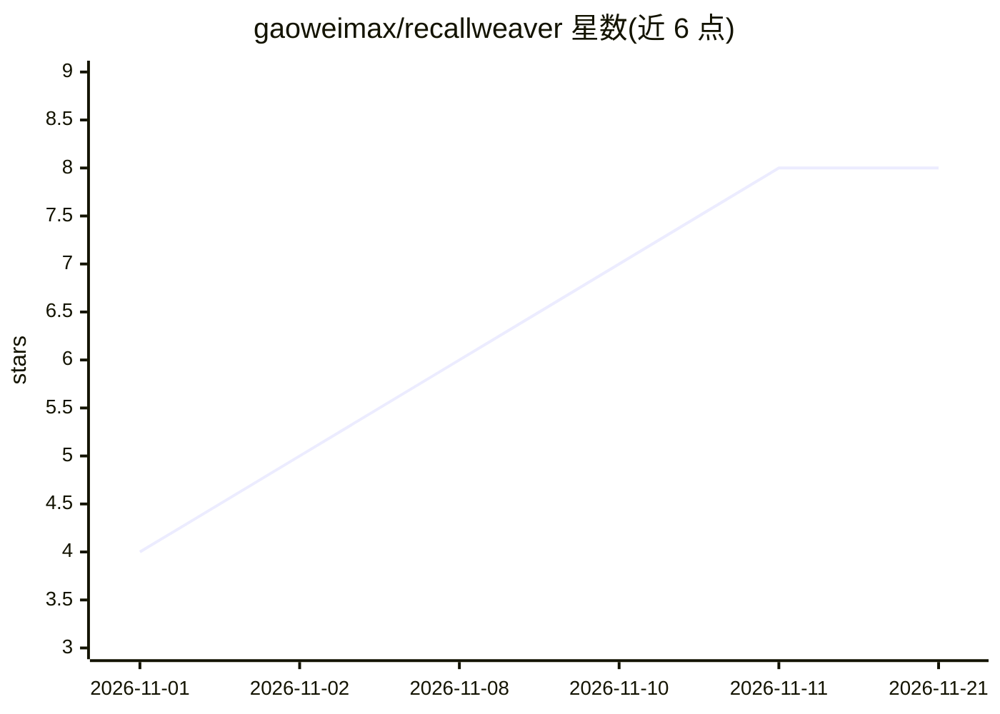

# gaoweimax/recallweaver

⭐ 8 · Python · 推送 2026-11-03 · [GitHub](https://github.com/gaoweimax/recallweaver) · 个人维护 · 中文 README

**给 LLM Agent 提供本地 SQLite 动态记忆的 Python 库**

面向 Python 开发者的本地记忆引擎：以双时间戳图谱区分事实的时间有效性（如当前住址与历史住址），用动态遗忘/衰减权重让低价值记忆沉底以节省 Token，检索过程带可解释性。数据存于单文件 SQLite，无需 Docker 与向量数据库。提供 Python API 写入与检索，支持按 tenant_id 隔离不同用户或 Agent 的记忆；另有接入 DSH 桌宠的 Node.js 插件包。要求 Python 3.11.9，当前进入被动维护状态。

## 筛选速览

| 维度 | 判定 | 备注 |
|---|---|---|
| AI 角色 | `ai-ecosystem` | LLM/agent 周边工具 |
| 许可风险 | `none` | — |
| 部署形态 | `library` | 以包/库形式分发 |
| 模型依赖 | — | README 未给出锁定关系 |
| 硬件要求 | — | 无带数字的原话,不猜 |
| 安装摩擦 | `low` | 无编译、无系统依赖或容器化 |
| 成熟度 | — | 结构信号不足 |

## 能力要点

- 双时间戳图谱区分事实的当前与历史状态
- 动态遗忘算法（衰减权重）降低低价值记忆的 Token 占用
- 记忆存本地单文件 SQLite，无需 Docker 与向量数据库
- tenant_id 隔离多用户/多 Agent 记忆，并附带压测脚本供复现

## 适用场景

- 为多轮对话 AI 应用保存并找回长期记忆
- 管理用户随时间变化的事实（如搬家、换工作）避免信息冲突
- 在无 GPU 的本地环境部署 Agent 记忆存储

## 场景标签

`Agent 记忆` · 领域:Agent 开发

## 证据(README 行号)

> L3: **面向 Python 开发者的本地 AI 动态记忆引擎。**
> L5: RecallWeaver 帮助 AI 应用把重要信息保存在本机，并在需要时重新找回来。记忆存放在本地单文件 SQLite 中，**不需要部署 Docker、不需要重型向量数据库**，纯 Python 打造。
> L14: **RecallWeaver 破局点**：通过**双时间戳图谱**让 AI 明白“你现在住上海，以前住北京”；通过**动态遗忘算法**让废话自动沉底，节省 Token；依靠纯本地 SQLite，实现零依赖极速部署。

## 星数曲线

2026-11-01 4 → 2026-11-21 8（+4）

---
*卡片 v1 · prompt 1.4 · 生成 2026-11-20 · 置信度 high · 依据 README sha `6d433ffa4624` · [字段定义](../../DATASET.md)*
