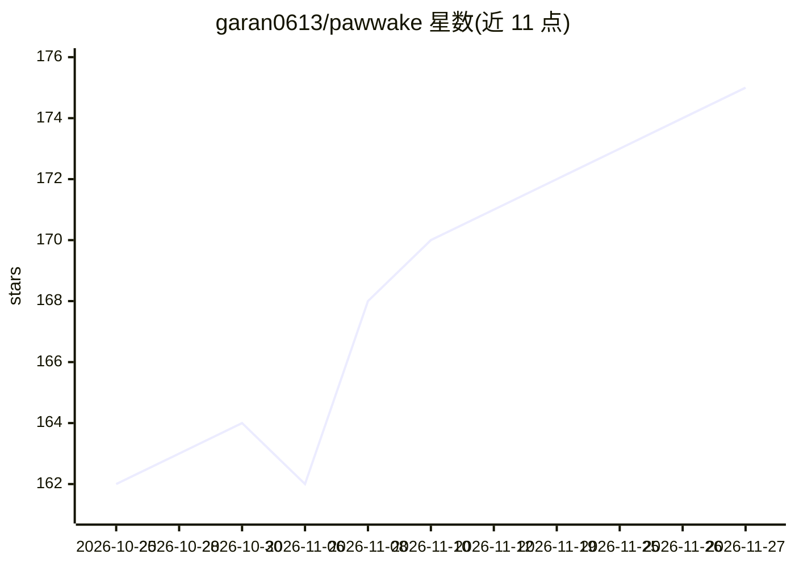

# garan0613/pawwake

⭐ 175 · Python · AGPL-3.0 · 推送 2026-11-10 · [GitHub](https://github.com/garan0613/pawwake) · 个人维护 · 中文 README

**给任意 LLM 客户端加长期记忆的转发网关**

部署在你与 LLM 服务商之间的 OpenAI 兼容转发网关：转发请求的同时从对话中自动提取记忆，按碎片→事件→核心三层架构存储，检索后注入后续对话；另提供 MCP 记忆工具、A/B 分区缓存借助 prompt caching 降低 token 开销、对话线管理与 token 统计。纯转发模式无需数据库，记忆功能需另备 PostgreSQL（如 pgvector）。通过 Dockerfile 部署到 Render/Railway 等平台，Dashboard 热更新配置。

## 筛选速览

| 维度 | 判定 | 备注 |
|---|---|---|
| AI 角色 | `ai-ecosystem` | LLM/agent 周边工具 |
| 许可风险 | `viral` | AGPL-3.0 |
| 部署形态 | `self-host` | docker 或自建部署 |
| 模型依赖 | local-ok | 支持本地模型 |
| 硬件要求 | — | 无带数字的原话,不猜 |
| 安装摩擦 | `low` | 无编译、无系统依赖或容器化 |
| 成熟度 | — | 结构信号不足 |

## 能力要点

- 三层记忆架构（碎片→事件→核心）与常驻标记注入
- 兼容任何 OpenAI 格式客户端与服务商，改 API_BASE_URL 即可切换
- A/B 区轮转分区缓存 + 摘要压缩以利用 prompt caching
- 通过 /mcp 提供八个记忆管理工具，支持远程 MCP 前端

## 适用场景

- 给 ChatBox/NextChat 等聊天客户端接入跨会话长期记忆
- 固定 session 实现多端对话衔接并节省 token 费用
- 给陪伴类 AI 批量导入预设背景信息并手动管理权重

## 场景标签

`Agent 记忆` · 领域:Agent 开发

## 证据(README 行号)

> L15: 一个轻量级转发网关，在你和 LLM 之间加一层记忆系统。支持任何 OpenAI 兼容客户端（Kelivo、ChatBox、NextChat 等）和任何 LLM 服务商（OpenRouter、OpenAI、本地 Ollama 等）。
> L23: - **三层记忆架构 + 常驻标记** — 碎片（自动提取的原始记忆）→ 事件（整理合并后的完整事件）→ 核心（手动标记的重要记忆），支持 AI 生成可编辑的整理草稿、核心候选、手动合并、撤回合并和查看来源；任意一层的记忆都可以设
> L232: |`/v1/chat/completions`|POST|核心转发接口（OpenAI 兼容）|

## 星数曲线

2026-10-25 162 → 2026-11-27 175（+13）

---
*卡片 v1 · prompt 1.4 · 生成 2026-11-26 · 置信度 mid · 依据 README sha `32d0aa0f8e4d` · [字段定义](../../DATASET.md)*
