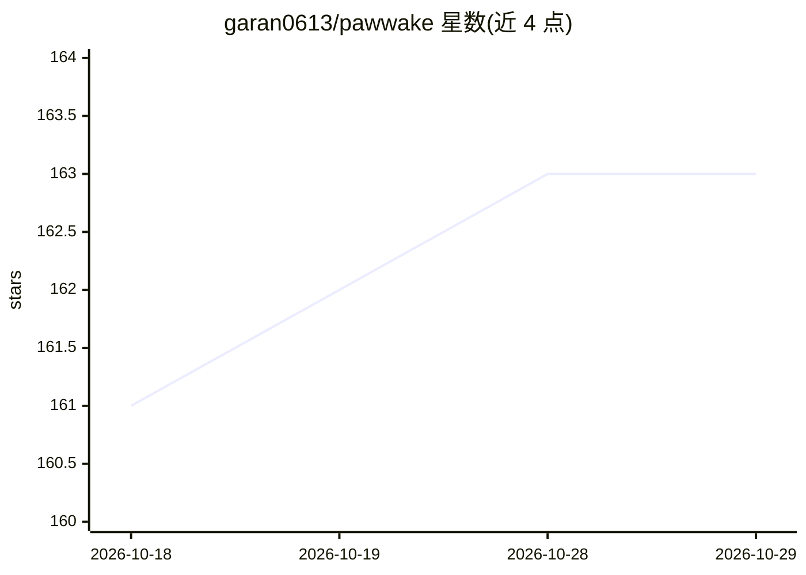

# garan0613/pawwake

⭐ 163 · Python · AGPL-3.0 · 推送 2026-10-22 · [GitHub](https://github.com/garan0613/pawwake) · 个人维护 · 中文 README

**给任意 LLM 客户端加长期记忆的 OpenAI 兼容转发网关**

Pawwake 是部署在客户端与 LLM 服务商之间的轻量代理网关，以 OpenAI 兼容接口（/v1/chat/completions）转发请求，并在链路中加入记忆系统：自动提取对话关键信息，下次对话时检索注入。记忆分碎片/事件/核心三层，支持关键词+向量混合搜索（可选 pgvector）。附带分区缓存（A/B 区轮转+摘要压缩）以利用 prompt caching 降低 token 开销，并提供带独立密码登录的 Dashboard 管理记忆、对话线与运行时配置。通过环境变量配置，可一键部署到 Render/Railway，需 PostgreSQL 才能开启记忆功能；纯转发模式无需数据库。

## 筛选速览

| 维度 | 判定 | 备注 |
|---|---|---|
| AI 角色 | `ai-ecosystem` | LLM/agent 周边工具 |
| 许可风险 | `viral` | AGPL-3.0 |
| 部署形态 | `self-host` | docker 或自建部署 |
| 模型依赖 | local-ok | 支持本地模型 |
| 硬件要求 | — | 无带数字的原话,不猜 |
| 安装摩擦 | `low` | 无编译、无系统依赖或容器化 |
| 成熟度 | — | 结构信号不足 |

## 能力要点

- 三层记忆架构（碎片→事件→核心），支持 AI 整理草稿、合并与撤回
- 分区缓存 A/B 区轮转+摘要压缩，利用 prompt caching 节省 token
- 关键词+语义向量四维混合搜索（可选，兼容 OpenAI 格式 Embedding API）
- Dashboard 一体化管理记忆、对话线、Token 统计，配置热更新

## 适用场景

- 给我的聊天客户端（ChatBox/Kelivo 等）加上跨会话长期记忆
- 通过网关自动管理对话上下文，降低 token 费用
- 在 Dashboard 里导入预置记忆、查看和编辑 AI 记住的内容

## 场景标签

`Agent 记忆` · 领域:Agent 开发

## 证据(README 行号)

> L15: 一个轻量级转发网关，在你和 LLM 之间加一层记忆系统。支持任何 OpenAI 兼容客户端（Kelivo、ChatBox、NextChat 等）和任何 LLM 服务商（OpenRouter、OpenAI、本地 Ollama 等）。
> L17: Give your AI long-term memory. A lightweight proxy gateway that adds a memory layer between you and any LLM.
> L222: |`/v1/chat/completions`|POST|核心转发接口（OpenAI 兼容）|

## 星数曲线

2026-10-18 161 → 2026-10-29 163（+2）

---
*卡片 v1 · prompt 1.4 · 生成 2026-10-22 · 置信度 mid · 依据 README sha `14bda30f4c5b` · [字段定义](../../DATASET.md)*
