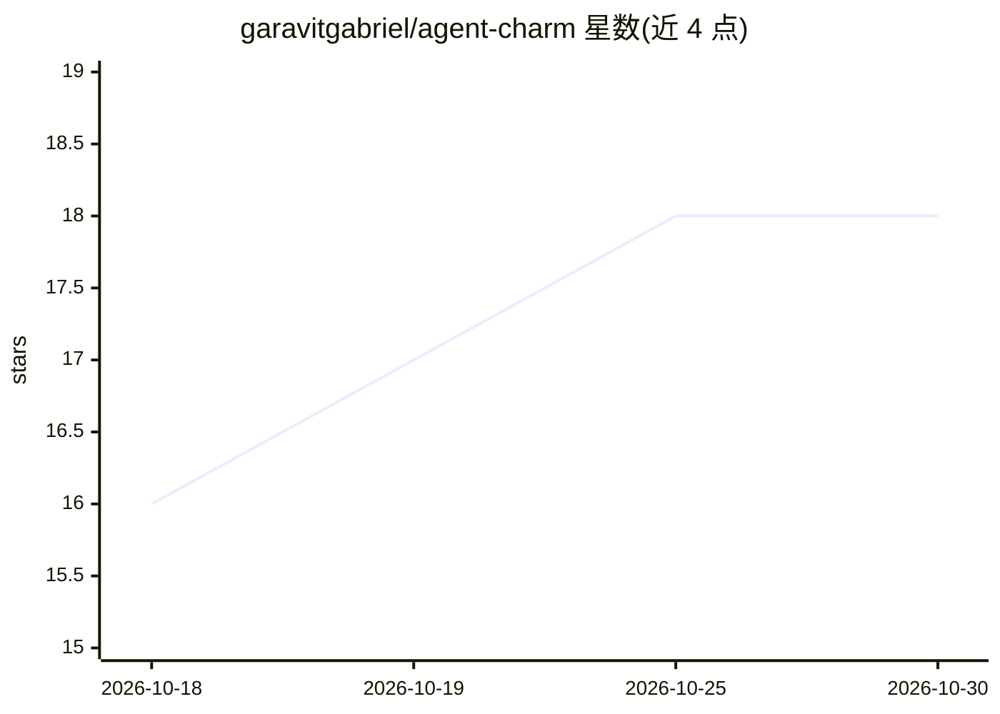

# garavitgabriel/agent-charm

⭐ 18 · C · MIT · 推送 2026-10-05 · [GitHub](https://github.com/garavitgabriel/agent-charm) · 个人维护

**ESP32-S3 AMOLED 桌面挂件：按键对话你已有的 AI agent**

运行在 Waveshare ESP32-S3-Touch-AMOLED-1.8（V2）硬件上的桌面角色挂件：屏上常驻动画角色 Dex，按住按钮说话，配套 Python 服务器经 faster-whisper 转录、调用 agent、以 Edge TTS 语音加屏幕卡片作答。Agent 可为任意 OpenAI 兼容端点或本地 Ollama/LM Studio。强调‘屏幕不说谎’状态与读不代操作原则。提供 macOS SDL2 模拟器无硬件运行，固件经 PlatformIO 烧录。限制：硬件仅支持 V2 板。

## 筛选速览

| 维度 | 判定 | 备注 |
|---|---|---|
| AI 角色 | `ai-native` | 本体是模型或模型工具 |
| 许可风险 | `permissive` | MIT |
| 部署形态 | `self-host` | docker 或自建部署 |
| 模型依赖 | local-ok | 支持本地模型 |
| 硬件要求 | — | 无带数字的原话,不猜 |
| 安装摩擦 | `low` | 无编译、无系统依赖或容器化 |
| 成熟度 | — | 结构信号不足 |

## 能力要点

- 按住即说话：faster-whisper 转录 + OpenAI 兼容模型 + Edge TTS 双句应答
- 任意 OpenAI 兼容端点或本地 Ollama / LM Studio 作为 agent
- 同一 LVGL UI 代码构建为 macOS SDL2 模拟器，无需硬件运行
- 角色可替换契约与第二 agent（Coach Beard）扩展示例

## 适用场景

- 给已在用的 agent 配一个随身带屏幕和麦克风的硬件入口
- 无硬件时在 macOS 模拟器上体验与开发界面
- 按角色替换契约制作自己的桌面 AI 角色

## 场景标签

`语音 Agent` · 领域:对话与助手

## 证据(README 行号)

> L10: Agent Charm is an ESP32-S3 with a 1.8" AMOLED screen, a mic and a speaker. An always-animated
> L13: sentences (Edge TTS). The agent can be **any OpenAI-compatible model** (OpenAI, Anthropic's

## 星数曲线

2026-10-18 16 → 2026-10-30 18（+2）

---
*卡片 v1 · prompt 1.4 · 生成 2026-10-29 · 置信度 high · 依据 README sha `893f8009e3e1` · [字段定义](../../DATASET.md)*
