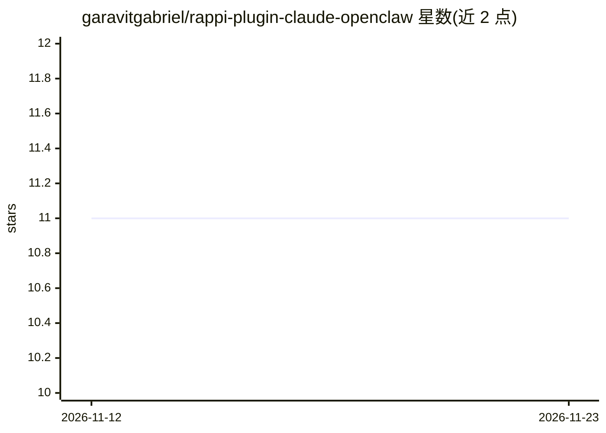

# garavitgabriel/rappi-plugin-claude-openclaw

⭐ 11 · Python · MIT · 推送 2026-09-28 · [GitHub](https://github.com/garavitgabriel/rappi-plugin-claude-openclaw) · 个人维护

**让 AI 助手通过对话在 Rappi 下单的插件**

面向哥伦比亚和墨西哥 Rappi 用户的 MCP 插件：将餐厅、超市、便利店、药房、酒类等商店类型的搜索、菜单浏览、购物车、结账、订单追踪封装为 41 个工具与 4 个工作流技能，供 Claude Code/Desktop/Cowork 与 OpenClaw 调用；附带独立 CLI 与交互式下单会话。本地 SQLite 记忆系统从订单历史构建口味画像，默认纯 SQL 实现，可选启用 OpenAI embeddings 提供语义搜索与相似度菜单评分。需 Python 3.12、uv 与 Rappi 账号认证。

## 筛选速览

| 维度 | 判定 | 备注 |
|---|---|---|
| AI 角色 | `ai-ecosystem` | LLM/agent 周边工具 |
| 许可风险 | `permissive` | MIT |
| 部署形态 | `library` | 以包/库形式分发 |
| 模型依赖 | locked-api |  |
| 硬件要求 | — | 无带数字的原话,不猜 |
| 安装摩擦 | `low` | 无编译、无系统依赖或容器化 |
| 成熟度 | — | 结构信号不足 |

## 能力要点

- 41 个 MCP 工具覆盖搜索、浏览、购物车、结账、订单追踪
- 本地 SQLite 口味画像：常点、时段模式、口味偏好等学习
- 默认纯 SQL 无外部 API，可选 text-embedding-3-small 语义功能
- 支持本地 stdio 与 Railway 远程 SSE 两种部署模式

## 适用场景

- 用自然语言让 Claude 帮我在 Rappi 点餐和比价
- 一键重下上次的订单或按习惯推荐吃什么
- 在终端里直接搜索商品、下单并实时追踪配送

## 场景标签

`AI 助手` · 领域:对话与助手

## 证据(README 行号)

> L40: The plugin gives your AI assistant **41 tools** across all Rappi store types, **4 workflow skills**, a specialized 
> L90: claude   # MCP server auto-registers from .mcp.json

## 星数曲线

2026-11-12 11 → 2026-11-23 11（+0）

---
*卡片 v1 · prompt 1.4 · 生成 2026-11-18 · 置信度 mid · 依据 README sha `c2ff9170bc52` · [字段定义](../../DATASET.md)*
