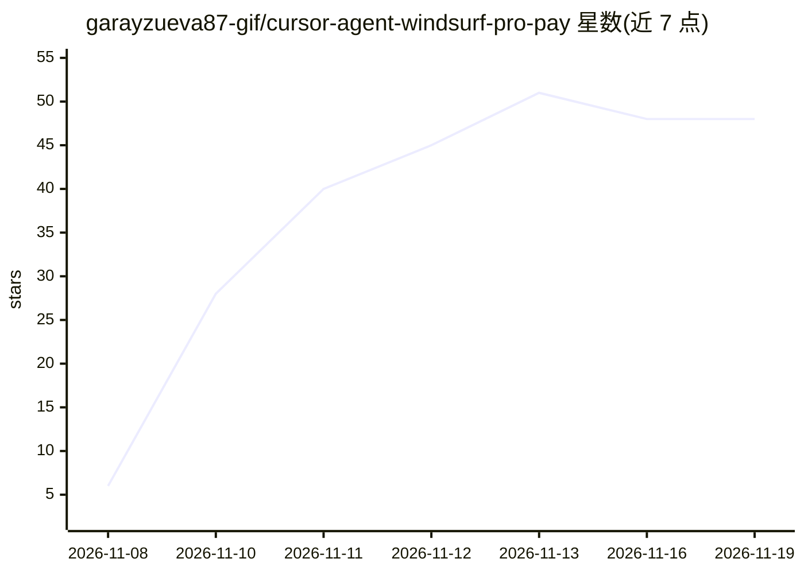

# garayzueva87-gif/cursor-agent-windsurf-pro-pay

⭐ 48 · 推送 2026-11-06 · [GitHub](https://github.com/garayzueva87-gif/cursor-agent-windsurf-pro-pay) · [官网](https://app.coregold.io/signup?invite_code=ADvlj9b) · 组织维护 · 中文 README

**推广 CoreGold 虚拟卡用于支付 Cursor/Windsurf 订阅的营销页**

仓库内容为 CoreGold 虚拟商业卡服务的推广文案，非软件代码：声称欧美 Tier-1 商业卡段可提高 Cursor Agent 与 Windsurf Pro/Business 订阅在 Stripe 的扣款通过率，支持 USDT 充值、单卡限额与一键注销，并给出三步开卡流程与控制台入口（入口为哈希串链接）。面向订阅被拒的开发者，无可安装程序，事实不可从代码层面验证。

## 筛选速览

| 维度 | 判定 | 备注 |
|---|---|---|
| AI 角色 | `ai-ecosystem` | LLM/agent 周边工具 |
| 许可风险 | `none` | — |
| 部署形态 | `None` |  |
| 模型依赖 | — | README 未给出锁定关系 |
| 硬件要求 | — | 无带数字的原话,不猜 |
| 安装摩擦 | `low` | 无编译、无系统依赖或容器化 |
| 成熟度 | — | 结构信号不足 |

## 能力要点

- 内容为虚拟卡支付服务推广文案，无代码或安装步骤
- 声称商业卡段配合北美账单地址可提高 Stripe 首绑通过率
- 给出 USDT 充值、下发卡片、填卡付款的三步流程

## 适用场景

- 了解 Cursor/Windsurf 订阅扣款被拒时的一种第三方支付途径说法
- 查看 CoreGold 虚拟卡的开卡与充值流程描述

## 场景标签

 · 领域:支付服务推广

## 证据(README 行号)

> L2: Cursor Agent 与 Windsurf Cascade 编程神器订阅防断流：CoreGold 虚拟卡解决 Stripe 拒付与多开账号连坐。
> L5: Cursor 与 Windsurf 的 Agent 模式全面接管多文件自动重构、错误自愈与终端流水线。但很多开发者在绑定 $20/月 Pro 版或 $40/月 Business 版时，Stripe 界面直接弹窗 `Your card

## 星数曲线

2026-11-08 6 → 2026-11-19 48（+42）

---
*卡片 v1 · prompt 1.4 · 生成 2026-11-18 · 置信度 low · 依据 README sha `45411c57ef04` · [字段定义](../../DATASET.md)*
