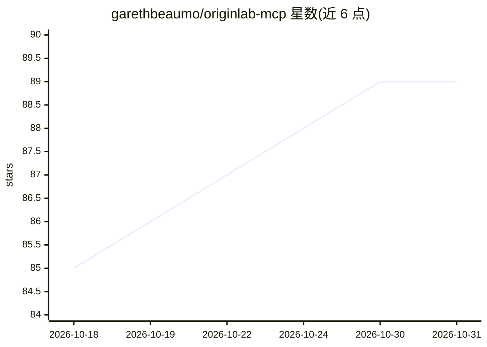

# garethbeaumo/originlab-mcp

⭐ 89 · Python · MIT · 推送 2026-10-29 · [GitHub](https://github.com/garethbeaumo/originlab-mcp) · 个人维护 · 中文 README

**通过 MCP 让 AI 客户端用自然语言操控 OriginLab 的桥接服务器**

连接 AI 客户端（Antigravity、Claude、Cursor 等）与 OriginLab 的 MCP 服务器，用 Python 编写，经 originpro 与 COM 接口通信。提供 67 个工具覆盖数据导入、绘图、图形定制、拟合分析、导出与项目管理，另有 MCP resources 只读读取会话、prompts 工作流模板，以及 execute_labtalk 逃逸通道。含破坏性操作前自动保存、软超时与目录白名单等安全机制。要求 Windows、OriginLab 2021+ 与 Python 3.10+。

## 筛选速览

| 维度 | 判定 | 备注 |
|---|---|---|
| AI 角色 | `ai-ecosystem` | LLM/agent 周边工具 |
| 许可风险 | `permissive` | MIT |
| 部署形态 | `library` | 以包/库形式分发 |
| 模型依赖 | — | README 未给出锁定关系 |
| 硬件要求 | — | 无带数字的原话,不猜 |
| 安装摩擦 | `low` | 无编译、无系统依赖或容器化 |
| 成熟度 | — | 结构信号不足 |

## 能力要点

- 67 个工具覆盖导入/绘图/定制/拟合/导出全流程
- MCP resources 只读会话快照与 prompts 工作流模板
- 破坏性操作前预检自动保存、COM 软超时、允许目录白名单
- 本地状态面板可测试连接并自动写客户端配置

## 适用场景

- 用对话让 AI 代为在 Origin 中导入数据、绘图并导出图片
- 通过自然语言执行线性/非线性拟合与出版级图形样式设置
- 让 AI 客户端只读检查当前 Origin 项目结构

## 场景标签

`数据分析` · 领域:效率与自动化

## 证据(README 行号)

> L19: OriginLab MCP Server is a bridge between AI clients and OriginLab. It lets you import data, create plots, customize
> L31: AI Client (Antigravity / Claude / Cursor)
> L33: OriginLab MCP Server (Python)

## 星数曲线

2026-10-18 85 → 2026-10-31 89（+4）

---
*卡片 v1 · prompt 1.4 · 生成 2026-10-23 · 置信度 high · 依据 README sha `dc607609b379` · [字段定义](../../DATASET.md)*
