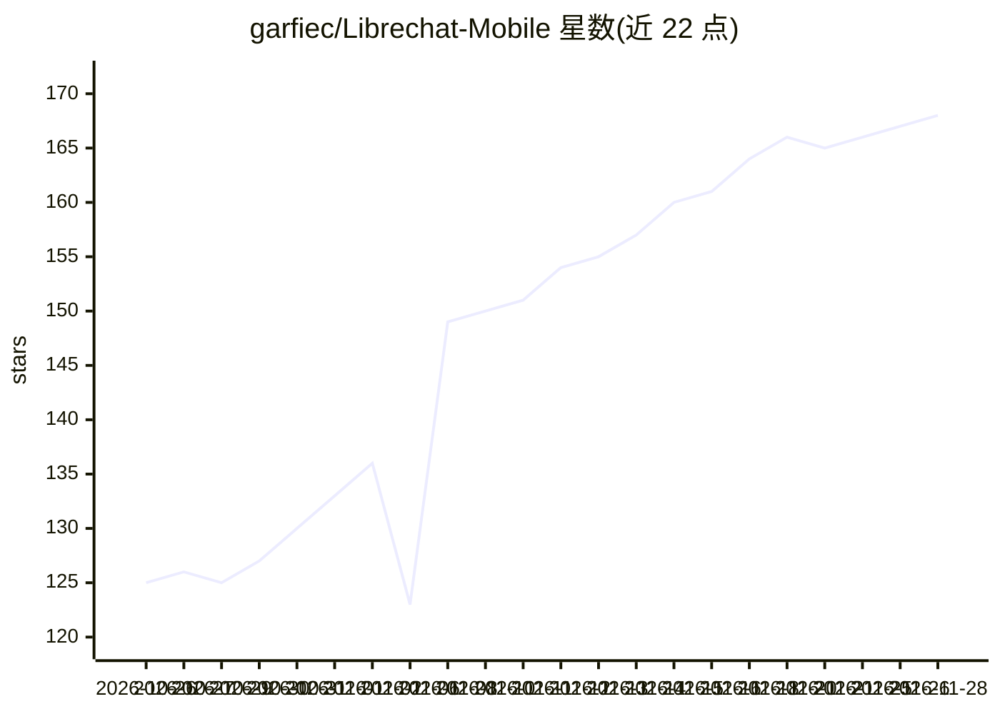

# garfiec/Librechat-Mobile

⭐ 168 · Kotlin · Apache-2.0 · 推送 2026-11-27 · [GitHub](https://github.com/garfiec/Librechat-Mobile) · 个人维护

**LibreChat 原生 Android/iOS 移动客户端：手机端连接自建 AI 服务**

将 LibreChat 网页应用重建为 Kotlin Multiplatform/Compose 原生移动应用，连接用户自有的 LibreChat 服务器使用。功能覆盖流式对话、消息分支、多账号多服务器切换、双模型并排对比、Agent 市场与 MCP 配置、内联 artifacts 渲染、定时聊天、离线缓存阅读与设备端语音听写。Android 通过 GitHub Releases APK、Obtainium、F-Droid、Google Play 分发，iOS 处于 TestFlight 公测；兼容服务端版本 v0.8.4–v0.8.9。

## 筛选速览

| 维度 | 判定 | 备注 |
|---|---|---|
| AI 角色 | `ai-ecosystem` | LLM/agent 周边工具 |
| 许可风险 | `permissive` | Apache-2.0 |
| 部署形态 | `desktop` | 安装包/桌面程序 |
| 模型依赖 | — | README 未给出锁定关系 |
| 硬件要求 | — | 无带数字的原话,不猜 |
| 安装摩擦 | `medium` | 含编译或系统依赖之一 |
| 成熟度 | — | 结构信号不足 |

## 能力要点

- 原生移动应用，支持多账号多服务器即时切换
- 双模型对比：同一消息同时发送到两个模型
- Agent 市场与 MCP 服务器配置，技能创建与导入
- 离线缓存会话列表与已读会话，支持后台预取

## 适用场景

- 在手机上访问自己部署的 LibreChat 服务器与多模型对话
- 在弱网或无网环境下继续阅读历史聊天记录
- 对比两个模型的回答并排查看
- 把模型生成的应用或图表固定到手机主屏幕

## 场景标签

`聊天机器人` · 领域:对话与助手

## 证据(README 行号)

> L5: All of LibreChat, built for Android and iOS. Switchboard keeps the experience you're used to while making it faster 
> L37: - **Everything where you'd look for it** — your model, its settings, tools, and attachments sit together right wher
> L51: - **Agents** — Marketplace with search and categories, MCP server configuration

## 星数曲线

2026-10-26 125 → 2026-11-28 168（+43）

---
*卡片 v1 · prompt 1.4 · 生成 2026-11-27 · 置信度 high · 依据 README sha `acb46b27eb58` · [字段定义](../../DATASET.md)*
