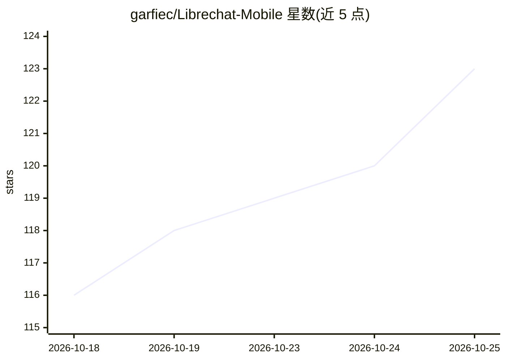

# garfiec/Librechat-Mobile

⭐ 123 · Kotlin · MIT · 推送 2026-10-24 · [GitHub](https://github.com/garfiec/Librechat-Mobile) · 个人维护

**LibreChat 的第三方原生移动客户端（Android/iOS）**

名为 Switchboard 的第三方移动应用，基于 Kotlin Multiplatform 与 Compose Multiplatform 构建，连接任意自托管 LibreChat 服务器，无需后端改动。功能包括多账户多服务器登录、实时流式对话、消息分支、离线阅读与全量搜索、内联 Artifacts 渲染（Mermaid/SVG/HTML/React/Markdown）、Agents 与技能管理、端侧语音听写。Android 提供签名 APK（可经 Obtainium 更新），iOS 经 TestFlight 分发或侧载未签名 ipa。服务器端需在 .env 添加 NON_BROWSER_VIOLATION_SCORE=0 以避免封禁计分；官方声明非 LibreChat 项目关联方。

## 筛选速览

| 维度 | 判定 | 备注 |
|---|---|---|
| AI 角色 | `ai-ecosystem` | LLM/agent 周边工具 |
| 许可风险 | `permissive` | MIT |
| 部署形态 | `desktop` | 安装包/桌面程序 |
| 模型依赖 | — | README 未给出锁定关系 |
| 硬件要求 | — | 无带数字的原话,不猜 |
| 安装摩擦 | `medium` | 含编译或系统依赖之一 |
| 成熟度 | — | 结构信号不足 |

## 能力要点

- 连接任意自托管 LibreChat 服务器，无需后端修改
- 多账户多服务器即时切换，聊天数据按账户隔离
- 离线阅读与全量消息搜索，支持背景预取
- 内联渲染 Mermaid/SVG/HTML/React/Markdown Artifacts，可固定到主屏幕（Android）

## 适用场景

- 在手机上原生使用自托管的 LibreChat 服务
- 多台服务器、多个账户间快速切换对话
- 断网或弱网环境下继续阅读历史对话

## 场景标签

`聊天机器人` `AI 助手` · 领域:对话与助手

## 证据(README 行号)

> L5: A third-party native mobile client for LibreChat (Android & iOS). Not affiliated with the official LibreChat project
> L28: - **Chat** — Real-time streaming (SSE), message branching & sibling navigation, stop/regenerate/continue, markdown 

## 星数曲线

2026-10-18 116 → 2026-10-25 123（+7）

---
*卡片 v1 · prompt 1.4 · 生成 2026-10-23 · 置信度 high · 依据 README sha `a38f42c02dd4` · [字段定义](../../DATASET.md)*
