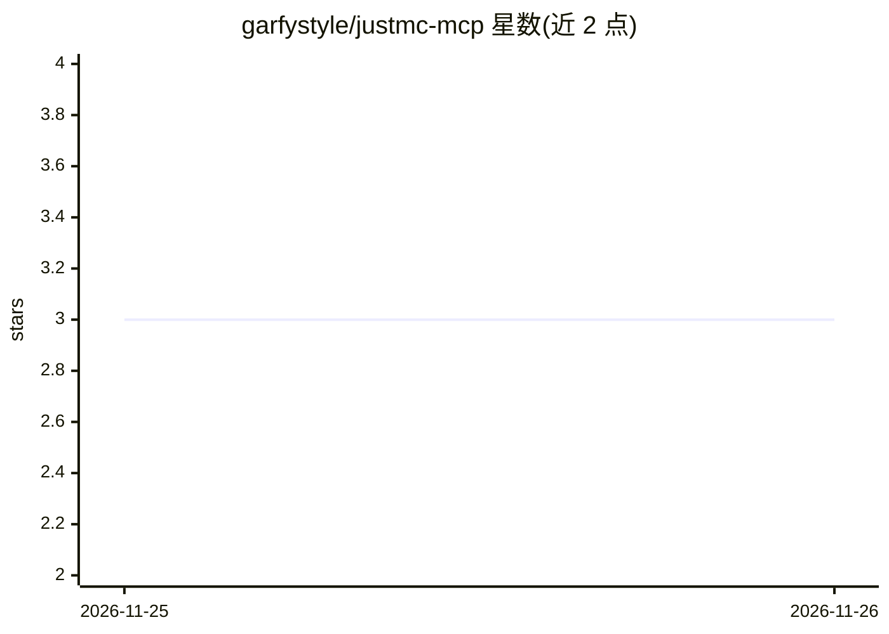

# garfystyle/justmc-mcp

⭐ 3 · JavaScript · 推送 2026-11-25 · [GitHub](https://github.com/garfystyle/justmc-mcp) · 个人维护

**给 AI 编程代理接 JustMC Creative+ 的 MCP 服务器**

面向 JustMC Creative+ 的 MCP 服务器：AI 代理用 Xero 语言写代码，通过工具注入世界并在游戏内自动验证。提供 ask/guide/find/examples 知识工具（基于 1075 个公开模块构建的知识库）、check/test/deploy 构建测试工具，以及玩家操控、截图等游戏交互工具。安装脚本自动向 Claude Code、Cursor 等 20 余款客户端注册服务器并分发技能文件；游戏内功能需 Minecraft 26.2 加 XeroCode 1.8.2 以上模组。

## 筛选速览

| 维度 | 判定 | 备注 |
|---|---|---|
| AI 角色 | `ai-ecosystem` | LLM/agent 周边工具 |
| 许可风险 | `none` | — |
| 部署形态 | `library` | 以包/库形式分发 |
| 模型依赖 | — | README 未给出锁定关系 |
| 硬件要求 | — | 无带数字的原话,不猜 |
| 安装摩擦 | `low` | 无编译、无系统依赖或容器化 |
| 成熟度 | — | 结构信号不足 |

## 能力要点

- 基于 1075 个 JustMC 公开模块构建的 Xero 语言知识库
- check/test/deploy 闭环：构建、入世界、按剧本走查并返回报告
- 一条安装命令向 20 余款 MCP 客户端自动注册服务器与技能
- 世界修改前自动备份，仅替换本项目代码

## 适用场景

- 用自然语言让 AI 代理编写并部署 JustMC 模块
- 在游戏内自动验证 Xero 代码的运行效果
- 查询 Xero 语言参考与其他模块的写法

## 场景标签

`编码 Agent` · 领域:编码与开发

## 证据(README 行号)

> L5:  MCP-сервер для JustMC Creative+ .
> L6:  Нейросеть пишет код на Xero, заливает его в мир и сама проверяет в игре.
> L60: Промпт `code` запускает весь цикл под задачу. Без игры работают `ask`, `guide`, `find`, `examples` и `check`.

## 星数曲线

2026-11-25 3 → 2026-11-26 3（+0）

---
*卡片 v1 · prompt 1.4 · 生成 2026-11-24 · 置信度 high · 依据 README sha `e9ff8f6637d4` · [字段定义](../../DATASET.md)*
