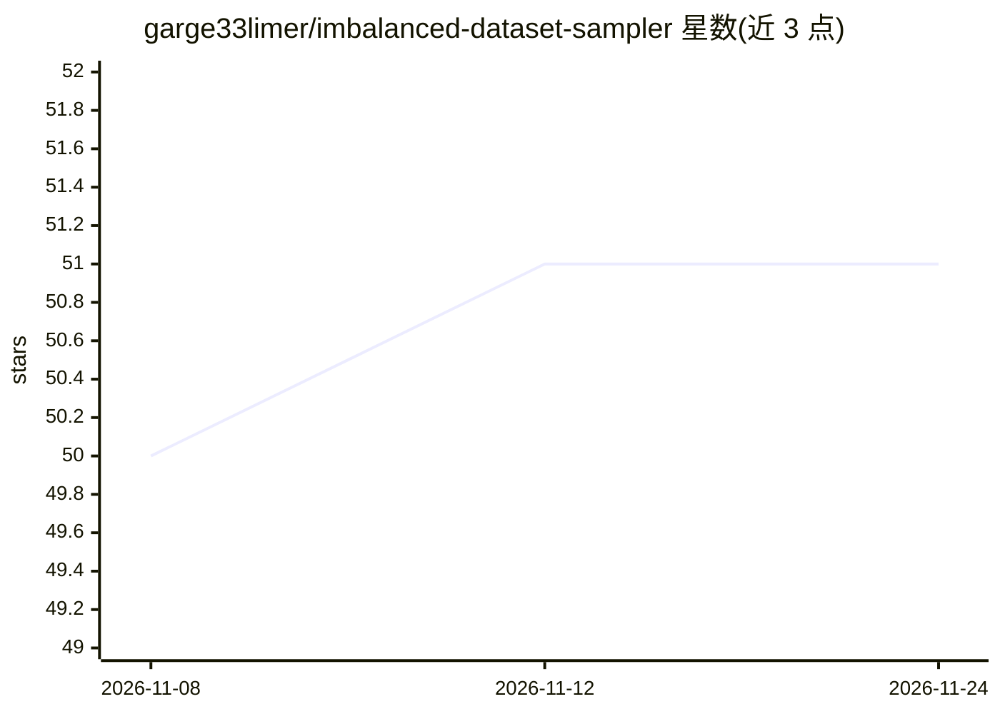

# garge33limer/imbalanced-dataset-sampler

⭐ 51 · Python · MIT · 推送 2026-11-05 · [GitHub](https://github.com/garge33limer/imbalanced-dataset-sampler) · 个人维护

**PyTorch 训练采样器：重采样缓解类别不平衡**

实现 ImbalancedDatasetSampler，一个 PyTorch Sampler 类，在训练时按类别出现频率的反比自动估算采样权重，重平衡不平衡数据集的类分布，无需新建平衡数据集。以 pip 安装的 torchsampler 包形式提供，传入 DataLoader 的 sampler 参数即可使用，可与数据增强结合以缓解过拟合。附有在不平衡 MNIST 数据集上的示例（含测试精度与混淆矩阵对比）。

## 筛选速览

| 维度 | 判定 | 备注 |
|---|---|---|
| AI 角色 | `ai-ecosystem` | LLM/agent 周边工具 |
| 许可风险 | `permissive` | MIT |
| 部署形态 | `library` | 以包/库形式分发 |
| 模型依赖 | — | README 未给出锁定关系 |
| 硬件要求 | — | 无带数字的原话,不猜 |
| 安装摩擦 | `low` | 无编译、无系统依赖或容器化 |
| 成熟度 | — | 结构信号不足 |

## 能力要点

- 按类别出现概率反比自动估算采样权重
- 采样时重平衡类分布，无需新建平衡数据集
- 可与数据增强结合缓解过拟合
- 以 torchsampler 包提供，传入 DataLoader 即可使用

## 适用场景

- 训练数据类别不平衡（如罕见病识别）时纠正模型偏置
- 在 PyTorch 训练流程中即插即用地做重采样
- 配合数据增强缓解少数类过采样导致的过拟合

## 场景标签

 · 领域:机器学习/训练工具

## 证据(README 行号)

> L15: In this repo, we implement an easy-to-use PyTorch sampler `ImbalancedDatasetSampler` that is able to
> L29: Simply pass an `ImbalancedDatasetSampler` for the parameter `sampler` when creating a `DataLoader`.

## 星数曲线

2026-11-08 50 → 2026-11-24 51（+1）

---
*卡片 v1 · prompt 1.4 · 生成 2026-11-18 · 置信度 high · 依据 README sha `2b45ac9e04cf` · [字段定义](../../DATASET.md)*
