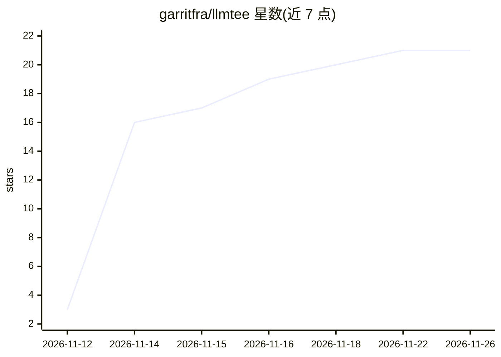

# garritfra/llmtee

⭐ 21 · Go · Apache-2.0 · 推送 2026-11-23 · [GitHub](https://github.com/garritfra/llmtee) · 个人维护

**给个人与小团队：自托管 LLM 代理，记录调用成本并设预算上限**

自托管的 OpenAI/Anthropic 及 OpenAI 兼容上游（OpenRouter、Ollama、vLLM、Groq）代理：客户端把 base URL 指向它，即记录每次请求的 token、成本、延迟与首 token 时间，同时透传响应。单个 Go 二进制加 SQLite（可选 PostgreSQL），提供按 key 的日/月预算（超限返回 429）、Web UI、CSV 导出、Prometheus 指标与 MCP 接口。无路由、fallback、评测与多租户功能；价格为构建时嵌入的 LiteLLM 价格表，不做 token 估算。当前 0.x 版本，配置可能在次版本间变动。

## 筛选速览

| 维度 | 判定 | 备注 |
|---|---|---|
| AI 角色 | `ai-ecosystem` | LLM/agent 周边工具 |
| 许可风险 | `permissive` | Apache-2.0 |
| 部署形态 | `self-host` | docker 或自建部署 |
| 模型依赖 | local-ok | 支持本地模型 |
| 硬件要求 | — | 无带数字的原话,不猜 |
| 安装摩擦 | `low` | 无编译、无系统依赖或容器化 |
| 成熟度 | `idea` | |

## 能力要点

- 记录每次请求的 token、成本、延迟与首 token 时间，响应原样透传
- 按 key 的日/月预算，超限返回 HTTP 429 且不再转发
- 单 Go 二进制 + SQLite，可选 PostgreSQL；提供 Web UI、CSV、Prometheus 与 MCP
- 价格表来自 LiteLLM，构建时嵌入并每周刷新，历史成本不随后续调价改变

## 适用场景

- 个人或小团队查看并封顶 LLM API 支出
- 让 Claude Code、Codex 等 agent 客户端不改代码接入以记录用量
- 给不同队友或 agent 发独立 key 并隐藏真实 provider key
- 通过 Prometheus 指标监控 LLM 调用的成本与延迟

## 场景标签

`模型网关` `LLM 可观测性` · 领域:Agent 开发

## 证据(README 行号)

> L3: **See what your LLM calls cost.** llmtee is a self-hosted proxy for the OpenAI and Anthropic APIs and for OpenAI-com
> L70: client ──► router ─► auth + budget ─► forwarder ─► upstream
> L74:           usage parser ─► pricing ─► batch writer ─► SQLite / PostgreSQL ─► UI, /metrics, MCP

## 星数曲线

2026-11-12 3 → 2026-11-26 21（+18）

---
*卡片 v1 · prompt 1.4 · 生成 2026-11-18 · 置信度 high · 依据 README sha `cd8faf76e685` · [字段定义](../../DATASET.md)*
