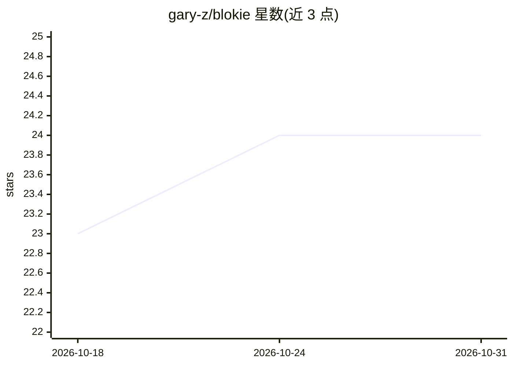

# gary-z/blokie

⭐ 24 · C++ · 推送 2026-08-28 · [GitHub](https://github.com/gary-z/blokie) · [官网](https://gary-z.github.io/blokie/) · 个人维护

**Blockudoku/Woodoku 类方块消除游戏的 AI 求解器**

面向 Blockudoku、Woodoku、Block Sudoku 的 AI 求解器：将每组三块视为一个动作，枚举所有合法放置顺序与位置，按占据格数、边缘锯齿、单格空洞、3×3 区域可用性等启发式评估选取最优解，平均每局约 110,000 次三块决策。棋盘以三个 32 位整数实现的 bitboard 表示；原生 C++ 引擎编译为 WebAssembly 供浏览器运行，并支持构建、测试、基准评估实验。明确声明不能自动操作手机游戏。

## 筛选速览

| 维度 | 判定 | 备注 |
|---|---|---|
| AI 角色 | `ai-native` | 本体是模型或模型工具 |
| 许可风险 | `none` | — |
| 部署形态 | `None` |  |
| 模型依赖 | — | README 未给出锁定关系 |
| 硬件要求 | — | 无带数字的原话,不猜 |
| 安装摩擦 | `low` | 无编译、无系统依赖或容器化 |
| 成熟度 | — | 结构信号不足 |

## 能力要点

- 三块一组联合规划，枚举全部合法放置顺序
- bitboard 棋盘表示（三个 32 位整数）
- C++ 引擎编译为 WebAssembly 支持浏览器运行
- 平均每局约 110,000 次三块决策

## 适用场景

- 为 Blockudoku/Woodoku 类游戏寻找高分解法
- 研究方块消除游戏的启发式评估与搜索
- 在浏览器中运行求解器实验

## 场景标签

`科研工具` · 领域:学习与行业

## 证据(README 行号)

> L1: Blokie is an AI solver for Blockudoku, Woodoku, and Block Sudoku. The current solver plays about 110,000 sets of thr
> L24: The board is a bitboard backed by three 32-bit integers. The solver enumerates

## 星数曲线

2026-10-18 23 → 2026-10-31 24（+1）

---
*卡片 v1 · prompt 1.4 · 生成 2026-10-27 · 置信度 high · 依据 README sha `0f12826402c1` · [字段定义](../../DATASET.md)*
