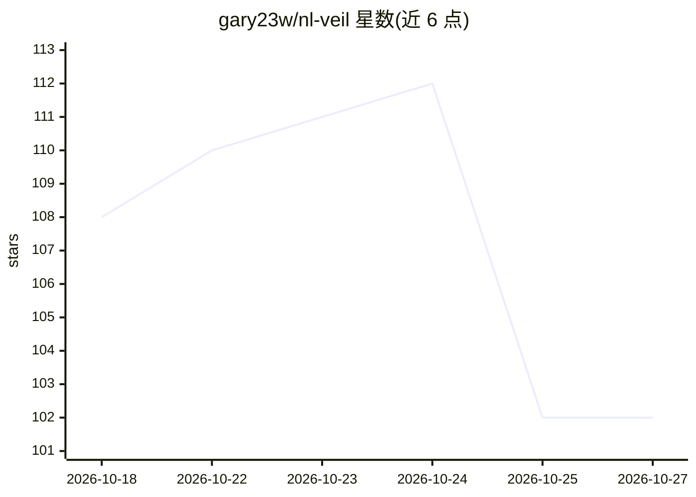

# gary23w/nl-veil

⭐ 102 · Zig · MIT · 推送 2026-10-22 · [GitHub](https://github.com/gary23w/nl-veil) · [官网](https://gary23w.github.io/nl-veil/) · 个人维护

**本地优先的 AI 编程桌面应用：多 agent 协作并记住项目**

开源桌面应用，用于以 AI 构建软件：给一个任务后由多个专家 agent 在共享工作目录上并行分工构建与互评，汇总为单一结果；内置记忆引擎在会话间累积代码知识与经真实命令验证的修复手册。单一 Zig 二进制包含桌面端、服务器、推理引擎与 CLI，内置模型从下载的 GGUF 进程内服务，可离线在 GPU 上运行 12B 模型，也可改用 Ollama 或任意 OpenAI 兼容端点；支持 Cloudflare 账号登录接入 Workers AI 与 R2 备份。编码工具链依赖 PATH 上的 Python（部分检查用 Node）。

## 筛选速览

| 维度 | 判定 | 备注 |
|---|---|---|
| AI 角色 | `ai-native` | 本体是模型或模型工具 |
| 许可风险 | `permissive` | MIT |
| 部署形态 | `desktop` | 安装包/桌面程序 |
| 模型依赖 | local-ok | 支持本地模型 |
| 硬件要求 | — | 无带数字的原话,不猜 |
| 安装摩擦 | `low` | 无编译、无系统依赖或容器化 |
| 成熟度 | — | 结构信号不足 |

## 能力要点

- 单一 Zig 二进制内置桌面端、推理引擎、记忆引擎与 CLI，离线运行 12B GGUF 模型
- 多专家 agent 并行分工，共享工作目录带独立版本控制并汇总回单一结果
- 记忆引擎跨会话累积代码知识与经真实退出码验证的修复手册
- ~58 个工具：文件、shell、测试、web、深度爬取、记忆、OCR、MCP、工具编写

## 适用场景

- 让一组 AI agent 在我的本地项目上并行完成编码任务
- 跨会话保留项目知识与验证过的修复经验，避免重复解决问题
- 无云端账号/API key 的前提下本地跑模型做 agentic 编程

## 场景标签

`编码 Agent` `多智能体` `Agent 记忆` · 领域:Agent 开发

## 证据(README 行号)

> L7: the Veil (nl-veil) is an open-source desktop app for building software with AI. Give it a task,
> L9: into your next session. Use the built-in model, Ollama, or an OpenAI-compatible endpoint.
> L74: **Local inference, with optional cloud connections.** One Zig binary carries the whole thing: the desktop app,

## 星数曲线

2026-10-18 108 → 2026-10-27 102（-6）

---
*卡片 v1 · prompt 1.4 · 生成 2026-10-23 · 置信度 mid · 依据 README sha `a0c6526d97fc` · [字段定义](../../DATASET.md)*
