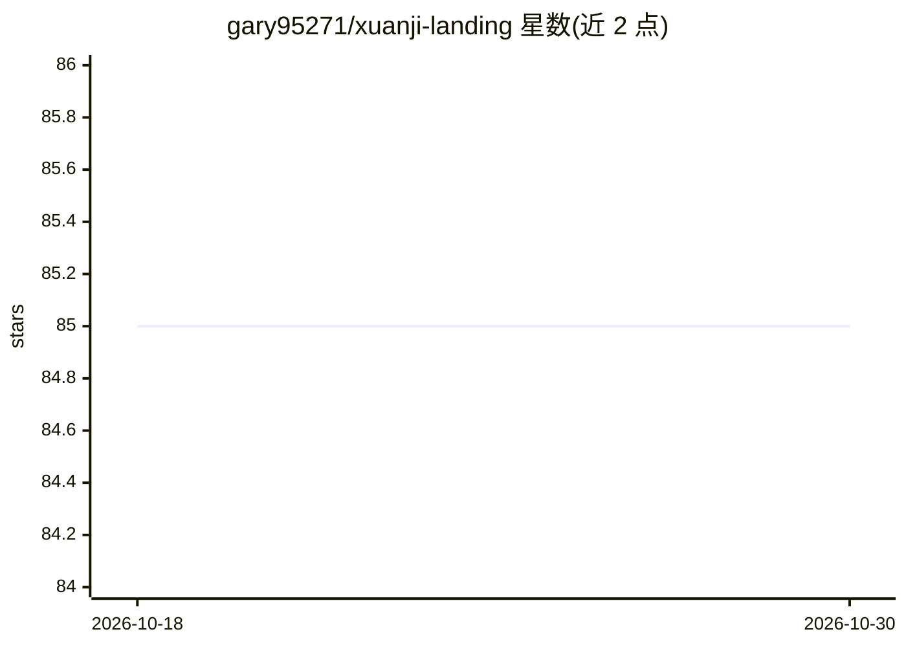

# gary95271/xuanji-landing

⭐ 85 · HTML · 推送 2026-06-14 · [GitHub](https://github.com/gary95271/xuanji-landing) · [官网](https://xuanji.dev) · 组织维护 · 中文 README

**国内直连 Claude/DeepSeek 的办公 AI 客户端服务平台宣传页**

本仓库托管 xuanji.dev 的官方宣传页（index.html + logo.svg），通过 GitHub Pages 服役。所宣传的产品为面向中国办公场景的 Claude 客户端 / Claude Code Agent 平台：提供网页端浏览器沙箱（浏览器内执行 Python 生成 PPT/Excel/Word/PDF）与 Mac/Windows 桌面客户端（IDE 式工作台，搭载 Claude Code Agent），接入 Claude Opus/Sonnet、DeepSeek v4、即梦 Seedance 文生图/视频等模型，按订阅或按量付费。Star 仓库可领取 7 天试用套餐。

## 筛选速览

| 维度 | 判定 | 备注 |
|---|---|---|
| AI 角色 | `ai-native` | 本体是模型或模型工具 |
| 许可风险 | `none` | — |
| 部署形态 | `None` |  |
| 模型依赖 | locked-api |  |
| 硬件要求 | — | 无带数字的原话,不猜 |
| 安装摩擦 | `low` | 无编译、无系统依赖或容器化 |
| 成熟度 | — | 结构信号不足 |

## 能力要点

- 网页端浏览器沙箱内执行 Python，现场生成 PPT/Excel/Word/PDF 且数据不离开浏览器
- 桌面客户端为 IDE 式工作台，搭载 Claude Code Agent，多轮自主规划批量产出汇报材料
- 接入即梦 Seedance 文生图/文生视频，一句话生成图片与视频
- 自营账号池与自研直连线路，宣称不封号不退款

## 适用场景

- 国内网络环境下使用 Claude 与 DeepSeek 模型进行日常对话与写作
- 让 AI 一句话生成可下载的 PPT / Word / Excel / PDF 办公文件
- 通过桌面客户端跑 Claude Code Agent 处理本地素材的长任务

## 场景标签

`编码 Agent` `图像生成` `视频生成` · 领域:编码与开发

## 证据(README 行号)

> L3: **面向中国办公场景的 Claude 客户端 / Claude Code Agent 平台**
> L39: |🌐 **网页端 · 浏览器沙箱**|打开网页即用，零安装。AI 在你的浏览器内**真实执行 Python**，现场生成 PPT / Excel / Word / PDF，做完直接下载 —— 数据全程不离开浏览器|
> L40: |💻 **桌面客户端 · 完整 Agent**|IDE 式工作台搭载完整 **Claude Code Agent**：读你的本地素材、多轮自主规划，批量产出整套汇报材料，重活长活交给它跑|

## 星数曲线

2026-10-18 85 → 2026-10-30 85（+0）

---
*卡片 v1 · prompt 1.4 · 生成 2026-10-24 · 置信度 mid · 依据 README sha `44e0f0681a65` · [字段定义](../../DATASET.md)*
