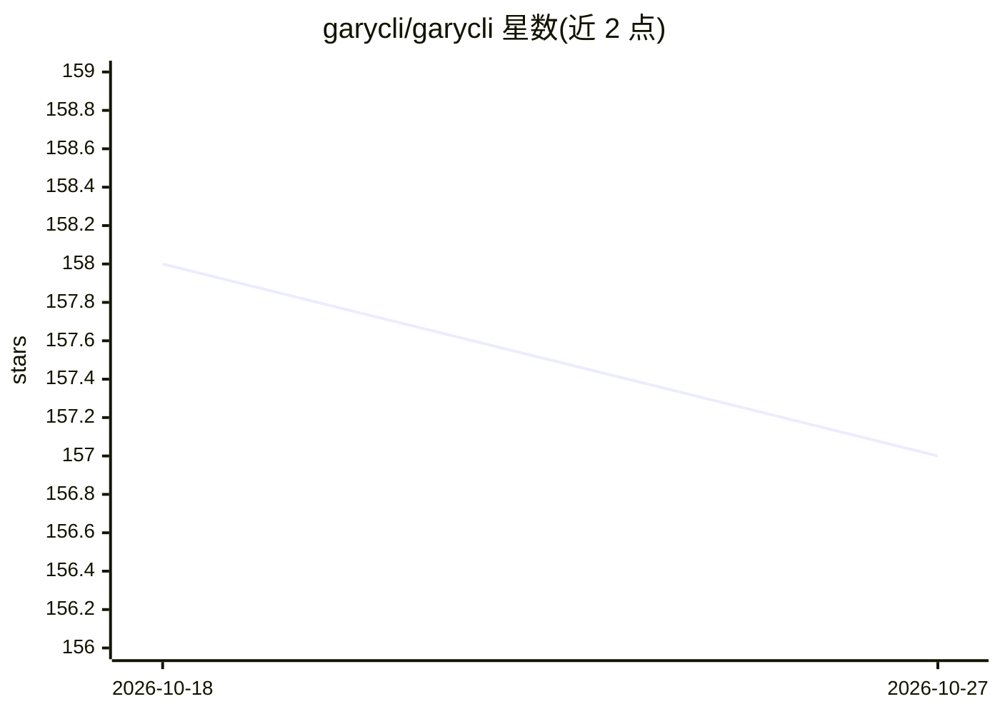

# garycli/garycli

⭐ 157 · Python · Apache-2.0 · 推送 2026-09-29 · [GitHub](https://github.com/garycli/garycli) · 个人维护 · 中文 README

**嵌入式工程 agent：从自然语言需求到代码、构建、烧录与验证修复**

面向嵌入式开发者的 CLI 工具：以自然语言下达任务，由 LLM 负责推理决策、确定性工具层负责编译、SWD/UART 烧录、串口监控、寄存器访问、MicroPython REPL 同步等工程操作，并按代码级到物理级五个层级的证据驱动闭环修复。支持 STM32F0/F1/F3/F4、RP2040、ESP32/ESP8266、CanMV K230 等平台，支持深度依平台而定。配套仪器 GaryProbe 的自动化物理检查仍在开发中。要求 Python 3.10+，后端支持 OpenAI 兼容、Anthropic Messages、Gemini 等多种 API。

## 筛选速览

| 维度 | 判定 | 备注 |
|---|---|---|
| AI 角色 | `ai-native` | 本体是模型或模型工具 |
| 许可风险 | `permissive` | Apache-2.0 |
| 部署形态 | `desktop` | 安装包/桌面程序 |
| 模型依赖 | — | README 未给出锁定关系 |
| 硬件要求 | — | 无带数字的原话,不猜 |
| 安装摩擦 | `medium` | 含编译或系统依赖之一 |
| 成熟度 | `idea` | |

## 能力要点

- 自然语言任务触发 HAL C 生成、GCC 构建、pyOCD/SWD 烧录与寄存器辅助调试
- RP2040/ESP32/ESP8266/CanMV K230 的 MicroPython raw-REPL 同步与 traceback 修复
- 构建失败后读取诊断信息定位问题并重试的闭环修复流程
- 可扩展 Skills（tools.py + schemas.json + prompt.md 结构）

## 适用场景

- 用自然语言让 agent 为 STM32 生成并烧录 LED/PWM/传感器示例代码
- 烧录后通过串口日志和寄存器状态诊断运行故障
- 在 RP2040/ESP32 上部署 MicroPython 并修复启动 traceback

## 场景标签

`编码 Agent` · 领域:编码与开发

## 证据(README 行号)

> L12: **GaryCLI is not just an AI code generator. It is an embedded engineering agent designed to execute as much of the 
> L43: > **Move from “AI wrote some embedded code” toward “AI completed a verifiable engineering task.”**
> L162: GaryCLI supports multiple backend styles, including OpenAI-compatible APIs, Anthropic Messages-style interfaces, G

## 星数曲线

2026-10-18 158 → 2026-10-27 157（-1）

---
*卡片 v1 · prompt 1.4 · 生成 2026-10-22 · 置信度 high · 依据 README sha `1ab1f7011833` · [字段定义](../../DATASET.md)*
