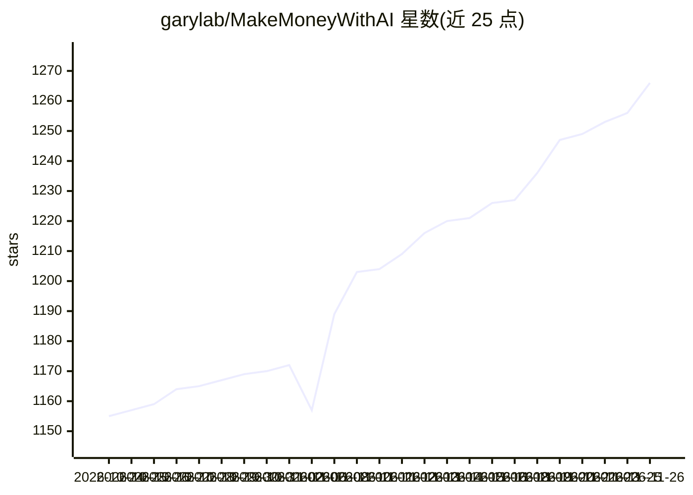

# garylab/MakeMoneyWithAI

⭐ 1,266 · Python · 推送 2026-11-25 · [GitHub](https://github.com/garylab/MakeMoneyWithAI) · 个人维护 · 中文 README

**为想用开源 AI 项目创收的人提供的策展清单**

以表格形式收录 53 个开源 AI 项目，每条列出名称、Star 数与对应的变现方式描述（如部署 SaaS、出售自动化流程、提供咨询服务等）。条目涵盖 agent 框架、工作流平台、图像/语音生成、爬虫、推理运行时等类别。README 仅由目录表格构成，未提供安装说明、运行方式或维护者信息，个别条目含中文描述。

## 筛选速览

| 维度 | 判定 | 备注 |
|---|---|---|
| AI 角色 | `ai-knowledge` | 知识聚合/清单类 |
| 许可风险 | `none` | — |
| 部署形态 | `None` |  |
| 模型依赖 | — | README 未给出锁定关系 |
| 硬件要求 | — | 无带数字的原话,不猜 |
| 安装摩擦 | `low` | 无编译、无系统依赖或容器化 |
| 成熟度 | — | 结构信号不足 |

## 能力要点

- 收录 53 个开源 AI 项目并附 Star 数
- 每个条目标注对应的变现途径描述
- 类别覆盖 agent、工作流、图像/语音、爬虫、推理运行时

## 适用场景

- 浏览可开源 AI 项目并了解各自的变现思路
- 按 Star 数了解项目热度排序

## 场景标签

`精选清单` · 领域:学习与行业

## 证据(README 行号)

> L3: **Make Money With AI** is a curated list of AI tools and projects that help you turn open-source into income.
> L5: |NO|Name|Stars|How to make money with this repository|

## 星数曲线

2026-10-24 1,155 → 2026-11-26 1,266（+111）

---
*卡片 v1 · prompt 1.4 · 生成 2026-11-26 · 置信度 high · 依据 README sha `e8ff33b74977` · [字段定义](../../DATASET.md)*
