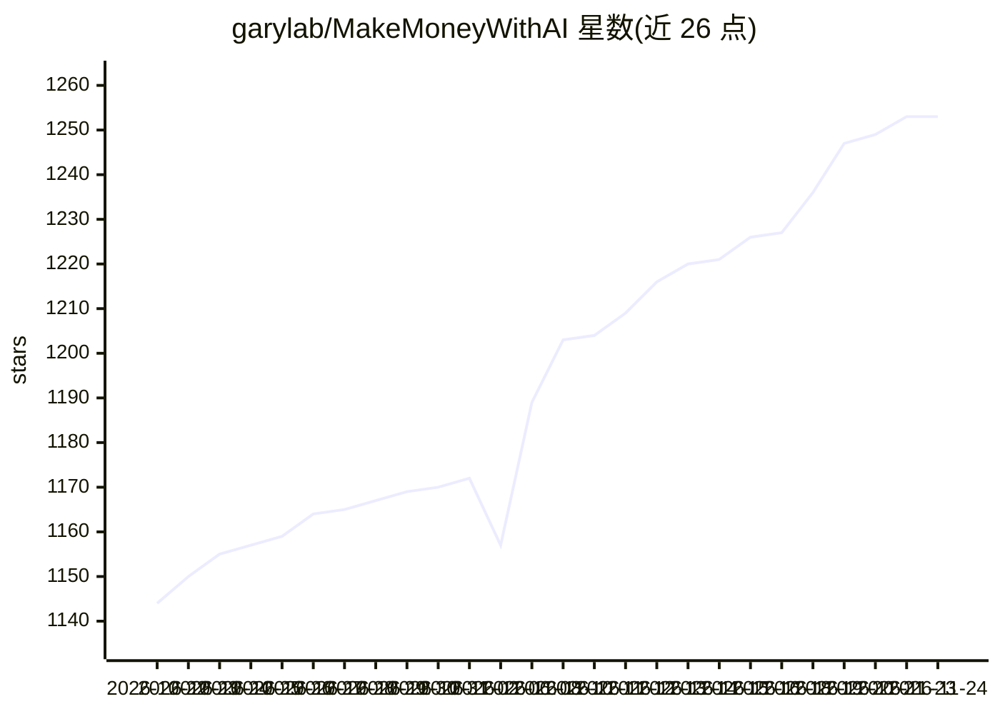

# garylab/MakeMoneyWithAI

⭐ 1,256 · Python · 推送 2026-11-23 · [GitHub](https://github.com/garylab/MakeMoneyWithAI) · 个人维护

**面向想用开源 AI 项目创收者的工具清单**

以表格形式收录 53 个开源 AI 项目，每条附 Star 数与一句

## 筛选速览

| 维度 | 判定 | 备注 |
|---|---|---|
| AI 角色 | `ai-knowledge` | 知识聚合/清单类 |
| 许可风险 | `none` | — |
| 部署形态 | `None` |  |
| 模型依赖 | — | README 未给出锁定关系 |
| 硬件要求 | — | 无带数字的原话,不猜 |
| 安装摩擦 | `low` | 无编译、无系统依赖或容器化 |
| 成熟度 | — | 结构信号不足 |

## 能力要点

- 以表格收录 53 个开源 AI 项目及 Star 数
- 每条附'如何用它赚钱'的一句话说明
- 覆盖 agent、工作流、推理、图像、语音、爬虫等多个方向

## 适用场景

- 寻找可用于副业创收的开源 AI 项目
- 了解热门 AI 开源项目在变现方向上的用法

## 场景标签

`精选清单` · 领域:学习与行业

## 证据(README 行号)

> L3: **Make Money With AI** is a curated list of AI tools and projects that help you turn open-source into income.
> L5: |NO|Name|Stars|How to make money with this repository|

## 星数曲线

2026-10-22 1,144 → 2026-11-24 1,253（+109）

---
*卡片 v1 · prompt 1.4 · 生成 2026-11-23 · 置信度 high · 依据 README sha `a17a88175d3d` · [字段定义](../../DATASET.md)*
