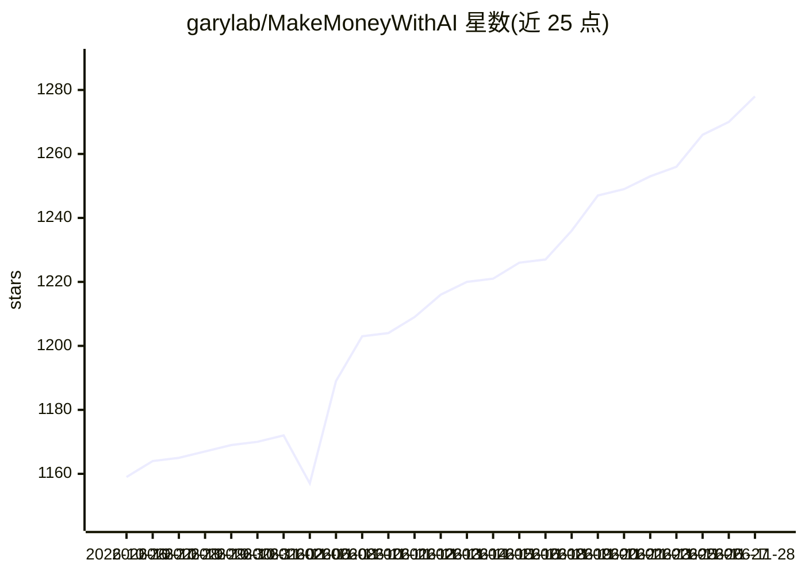

# garylab/MakeMoneyWithAI

⭐ 1,278 · Python · 推送 2026-11-27 · [GitHub](https://github.com/garylab/MakeMoneyWithAI) · 个人维护 · 中文 README

**开发者可变现的开源 AI 项目策展清单（53 项）**

以表格形式维护的开源项目清单，收录 53 个仓库，每条列出星标数与该项目的变现路径描述（SaaS、自动化服务、内容生成、咨询等），覆盖 agent 框架、LLM 推理运行时、RAG 平台、图像/视频生成、爬虫与语音工具等类别。清单本身不提供安装或运行指引，仅做条目罗列与一句话说明，面向希望通过开源 AI 项目获得收入的读者。

## 筛选速览

| 维度 | 判定 | 备注 |
|---|---|---|
| AI 角色 | `ai-knowledge` | 知识聚合/清单类 |
| 许可风险 | `none` | — |
| 部署形态 | `None` |  |
| 模型依赖 | — | README 未给出锁定关系 |
| 硬件要求 | — | 无带数字的原话,不猜 |
| 安装摩擦 | `low` | 无编译、无系统依赖或容器化 |
| 成熟度 | — | 结构信号不足 |

## 能力要点

- 收录 53 个开源 AI 仓库并附星标数
- 每条目给出对应的变现途径描述
- 覆盖 agent、推理、RAG、图像视频、爬虫等多类别

## 适用场景

- 寻找可用于副业变现的开源 AI 项目
- 按类别浏览热门 agent 与 LLM 工具生态
- 评估哪些开源项目适合做成 SaaS 或服务

## 场景标签

`精选清单` · 领域:学习与行业

## 证据(README 行号)

> L3: **Make Money With AI** is a curated list of AI tools and projects that help you turn open-source into income.
> L5: |NO|Name|Stars|How to make money with this repository|
> L6: |---|---|---|---|

## 星数曲线

2026-10-26 1,159 → 2026-11-28 1,278（+119）

---
*卡片 v1 · prompt 1.4 · 生成 2026-11-28 · 置信度 high · 依据 README sha `4783ef58388d` · [字段定义](../../DATASET.md)*
