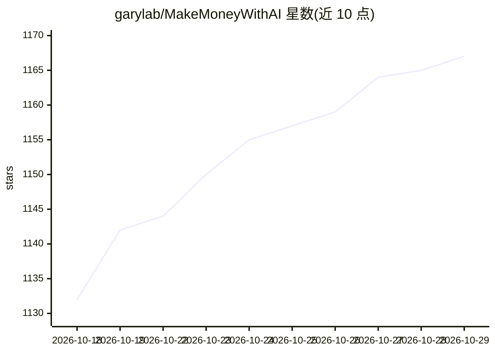

# garylab/MakeMoneyWithAI

⭐ 1,167 · Python · 推送 2026-10-28 · [GitHub](https://github.com/garylab/MakeMoneyWithAI) · 个人维护

**开源 AI 项目变现策展清单（49 项，含变现路径说明）**

由 garylab 维护的策展清单：收录 49 个开源 AI 项目（openclaw、AutoGPT、n8n、ollama、stable-diffusion-webui、ComfyUI、MoneyPrinterTurbo 等），每条给出名称、GitHub 星标数与“如何用该仓库赚钱”的文字说明，覆盖部署私有 LLM、构建 SaaS、自动化工作流、内容生成、微调服务等变现方向。列表为单一表格形式，未提供清单自身的安装方式，星标数据以快照形式呈现。

## 筛选速览

| 维度 | 判定 | 备注 |
|---|---|---|
| AI 角色 | `ai-knowledge` | 知识聚合/清单类 |
| 许可风险 | `none` | — |
| 部署形态 | `None` |  |
| 模型依赖 | — | README 未给出锁定关系 |
| 硬件要求 | — | 无带数字的原话,不猜 |
| 安装摩擦 | `low` | 无编译、无系统依赖或容器化 |
| 成熟度 | — | 结构信号不足 |

## 能力要点

- 收录 49 个开源 AI 项目及各自星标数
- 每条目附 monetization 路径说明（SaaS/自动化/咨询/API 等）
- 条目覆盖 agent 框架、推理运行时、生成工具、爬虫与微调库等多类项目

## 适用场景

- 寻找可用于构建付费服务或 SaaS 的开源 AI 项目
- 按星标与变现路径粗筛候选开源方案
- 了解开源 AI 项目的常见商业化方式

## 场景标签

`精选清单` · 领域:学习与行业

## 证据(README 行号)

> L3: **Make Money With AI** is a curated list of AI tools and projects that help you turn open-source into income.
> L5: |NO|Name|Stars|How to make money with this repository|

## 星数曲线

2026-10-18 1,132 → 2026-10-29 1,167（+35）

---
*卡片 v1 · prompt 1.4 · 生成 2026-10-21 · 置信度 high · 依据 README sha `3adc785ce1fe` · [字段定义](../../DATASET.md)*
