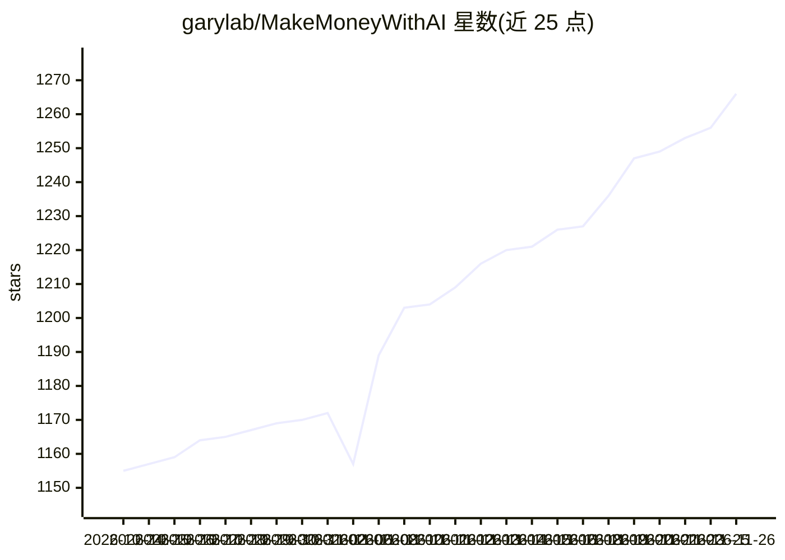

# garylab/MakeMoneyWithAI

⭐ 1,266 · Python · 推送 2026-11-25 · [GitHub](https://github.com/garylab/MakeMoneyWithAI) · 个人维护

**开源 AI 项目变现清单：按赚钱方式收录 53 个项目**

一份策展清单，收录 53 个开源 AI 项目并以表格形式标注 Star 数和对应变现思路（SaaS、咨询、自动化服务、内容生成等）。条目覆盖 agent 框架、工作流平台、推理运行时、图像/视频/语音生成、爬虫、RAG 等类别。本身不含安装说明或使用教程，仅为项目名称、Star 数与变现描述的列表，面向希望利用开源 AI 项目产生收入的人群。

## 筛选速览

| 维度 | 判定 | 备注 |
|---|---|---|
| AI 角色 | `ai-knowledge` | 知识聚合/清单类 |
| 许可风险 | `none` | — |
| 部署形态 | `None` |  |
| 模型依赖 | — | README 未给出锁定关系 |
| 硬件要求 | — | 无带数字的原话,不猜 |
| 安装摩擦 | `low` | 无编译、无系统依赖或容器化 |
| 成熟度 | — | 结构信号不足 |

## 能力要点

- 收录 53 个开源 AI 项目并附 Star 数
- 每个条目给出对应的变现方式描述
- 覆盖 agent、工作流、推理、图像、语音、爬虫等多类别

## 适用场景

- 寻找可用于变现的开源 AI 项目方向
- 了解哪些开源 AI 项目 Star 数较高
- 按变现思路（SaaS/咨询/内容）挑选项目

## 场景标签

`精选清单` · 领域:学习与行业

## 证据(README 行号)

> L3: **Make Money With AI** is a curated list of AI tools and projects that help you turn open-source into income.
> L5: |NO|Name|Stars|How to make money with this repository|
> L6: |---|---|---|---|

## 星数曲线

2026-10-24 1,155 → 2026-11-26 1,266（+111）

---
*卡片 v1 · prompt 1.4 · 生成 2026-11-25 · 置信度 high · 依据 README sha `4f939594f303` · [字段定义](../../DATASET.md)*
