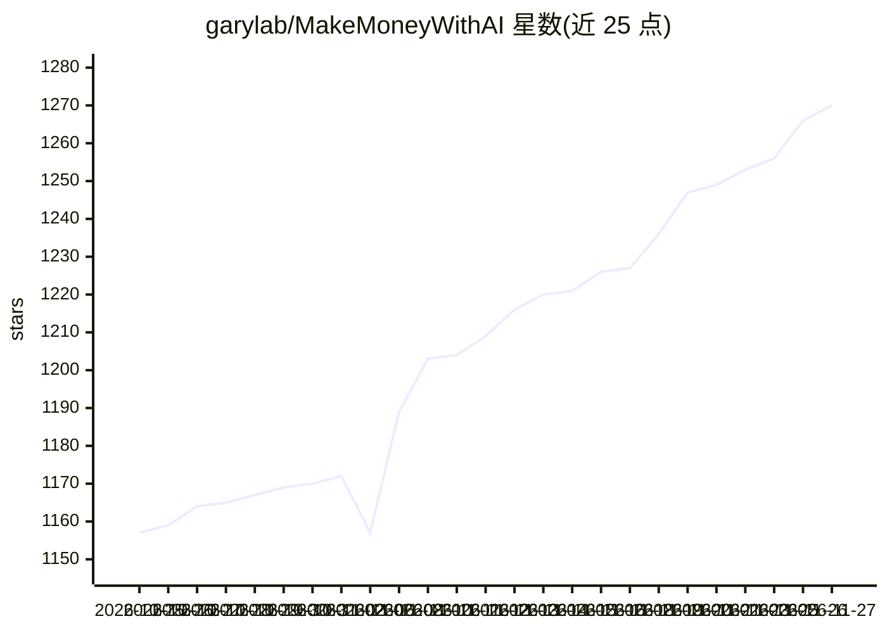

# garylab/MakeMoneyWithAI

⭐ 1,270 · Python · 推送 2026-11-26 · [GitHub](https://github.com/garylab/MakeMoneyWithAI) · 个人维护 · 中文 README

**面向想用开源 AI 项目创收者的项目清单**

以表格形式列出 53 个开源 AI 项目的星标数与商业化途径说明，覆盖 agent 框架、工作流编排、LLM 推理、图像/视频生成、爬虫、RAG 等类别，每个条目附一行变现方式描述（SaaS、订阅、咨询、API 集成等）。内容为链接型清单，无安装或运行说明；条目按星标数排列，含少量中文描述条目。

## 筛选速览

| 维度 | 判定 | 备注 |
|---|---|---|
| AI 角色 | `ai-knowledge` | 知识聚合/清单类 |
| 许可风险 | `none` | — |
| 部署形态 | `None` |  |
| 模型依赖 | — | README 未给出锁定关系 |
| 硬件要求 | — | 无带数字的原话,不猜 |
| 安装摩擦 | `low` | 无编译、无系统依赖或容器化 |
| 成熟度 | — | 结构信号不足 |

## 能力要点

- 53 个开源 AI 项目的表格化清单，含星标数与变现思路
- 覆盖 agent、工作流、推理、图像生成、爬虫、RAG 等类别
- 每个条目给出对应的商业化途径描述

## 适用场景

- 浏览有哪些可商用的开源 AI 项目
- 为选择开源项目做副业或 SaaS 寻找线索
- 了解 AI 工具生态的热门项目排名

## 场景标签

`精选清单` · 领域:学习与行业

## 证据(README 行号)

> L3: **Make Money With AI** is a curated list of AI tools and projects that help you turn open-source into income.
> L5: |NO|Name|Stars|How to make money with this repository|

## 星数曲线

2026-10-25 1,157 → 2026-11-27 1,270（+113）

---
*卡片 v1 · prompt 1.4 · 生成 2026-11-27 · 置信度 high · 依据 README sha `7b9de72c2c19` · [字段定义](../../DATASET.md)*
