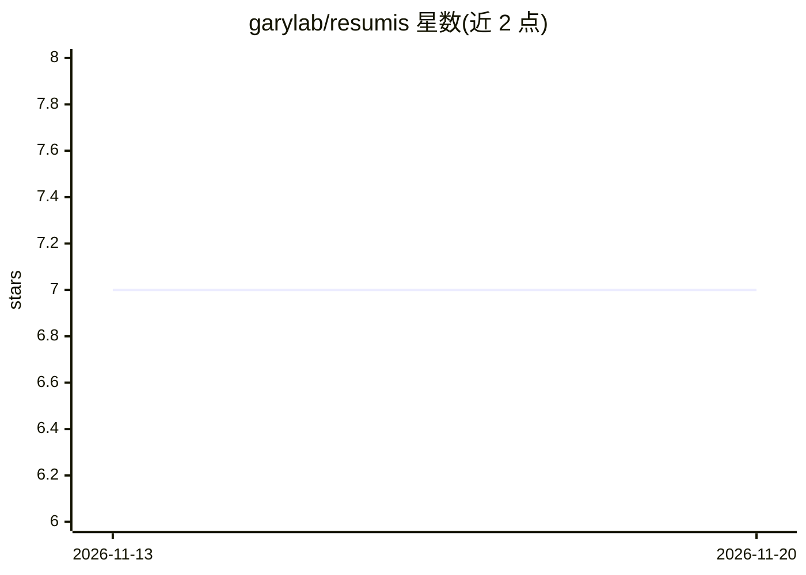

# garylab/resumis

⭐ 7 · JavaScript · MIT · 推送 2026-11-14 · [GitHub](https://github.com/garylab/resumis) · [官网](https://resumis.com) · 个人维护

**浏览器内的 Markdown 简历编辑器，保存到 GitHub 仓库**

基于 Cloudflare Workers 运行的开源简历编辑器，无需数据库。用户在浏览器中编写 Markdown 简历并实时预览，支持 8 种模板、快速样式、高级 CSS、照片上传、A4/US Letter 版式与浏览器 PDF 导出；每份简历以 resume.md、style.css 与可选 photo.jpg 存入用户 GitHub 仓库，支持仓库/分支选择、保存、重命名、复制与删除。GitHub 登录与保存需配置 OAuth 凭据，本地编辑与 PDF 导出无需凭据。

## 筛选速览

| 维度 | 判定 | 备注 |
|---|---|---|
| AI 角色 | `ai-enhanced` | 去掉 AI 部分产品仍成立 |
| 许可风险 | `permissive` | MIT |
| 部署形态 | `library` | 以包/库形式分发 |
| 模型依赖 | — | README 未给出锁定关系 |
| 硬件要求 | — | 无带数字的原话,不猜 |
| 安装摩擦 | `low` | 无编译、无系统依赖或容器化 |
| 成熟度 | — | 结构信号不足 |

## 能力要点

- Markdown 编辑 + 实时预览，简历以文件形式存入用户 GitHub 仓库
- 8 种模板、Quick styles 与 Advanced CSS 可视化控制
- A4/US Letter 版式与浏览器 PDF 导出
- 运行于 Cloudflare Workers，无需数据库

## 适用场景

- 在浏览器里编写并预览 Markdown 简历
- 将简历作为文件版本化地保存在自己的 GitHub 仓库中
- 导出 A4 或 US Letter 版式的 PDF 简历

## 场景标签

 · 领域:效率工具/文档编辑

## 证据(README 行号)

> L21: Build Markdown resumes with live preview and save them to your GitHub repository. Runs on Cloudflare Workers; no da
> L34: Requires Node.js 22+ and npm.

## 星数曲线

2026-11-13 7 → 2026-11-20 7（+0）

---
*卡片 v1 · prompt 1.4 · 生成 2026-11-20 · 置信度 mid · 依据 README sha `6b2349082051` · [字段定义](../../DATASET.md)*
