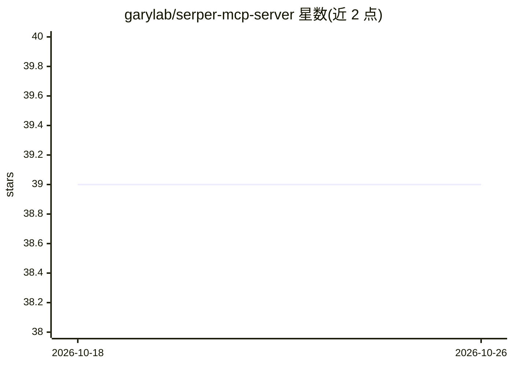

# garylab/serper-mcp-server

⭐ 39 · Python · 推送 2025-11-10 · [GitHub](https://github.com/garylab/serper-mcp-server) · [官网](https://pypi.org/project/serper-mcp-server/) · 个人维护

**让 LLM 通过 Serper 调用 Google 搜索的 MCP 服务器**

基于 Model Context Protocol 的服务器，封装 Serper 的 Google 搜索 API，使 LLM/MCP 客户端（如 Claude Desktop）能获取 Google 搜索结果。提供 13 个工具，覆盖网页、图片、视频、地图、学术、专利、购物、自动补全等搜索类型及网页抓取。安装方式包括 Smithery（npx 一键装到 Claude Desktop）、uvx 从 PyPI 拉取、pip 全局或项目安装；需 SERPER_API_KEY，可用 MCP inspector 调试。

## 筛选速览

| 维度 | 判定 | 备注 |
|---|---|---|
| AI 角色 | `ai-ecosystem` | LLM/agent 周边工具 |
| 许可风险 | `none` | — |
| 部署形态 | `library` | 以包/库形式分发 |
| 模型依赖 | — | README 未给出锁定关系 |
| 硬件要求 | — | 无带数字的原话,不猜 |
| 安装摩擦 | `low` | 无编译、无系统依赖或容器化 |
| 成熟度 | — | 结构信号不足 |

## 能力要点

- 13 个搜索工具：网页/图片/视频/地图/新闻/学术/专利/购物/lens/评论/地点/自动补全及网页抓取
- 支持 Smithery、uvx、pip 多种安装与接入方式
- 可接入 Claude Desktop 或其他 MCP 客户端

## 适用场景

- 给 Claude Desktop 等 MCP 客户端接入 Google 搜索能力
- 让 agent 在回答前检索最新网络信息
- 构建需要网页抓取与多类型搜索的 LLM 工具链

## 场景标签

`网页抓取` · 领域:效率与自动化

## 证据(README 行号)

> L8: A Model Context Protocol server that provides **Google Search via Serper**. This server enables LLMs to get search r
> L40: 2. In your MCP client code configuration or **Claude** settings (file `claude_desktop_config.json`) add `serper` mc

## 星数曲线

2026-10-18 39 → 2026-10-26 39（+0）

---
*卡片 v1 · prompt 1.4 · 生成 2026-10-25 · 置信度 high · 依据 README sha `42e527a231f0` · [字段定义](../../DATASET.md)*
