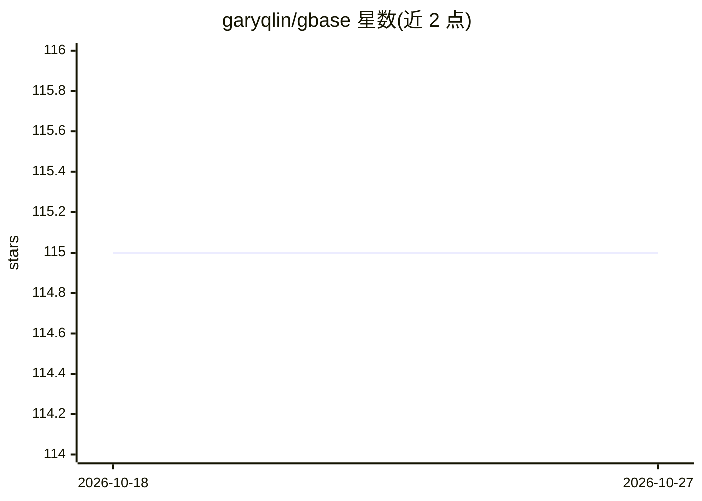

# garyqlin/gbase

⭐ 115 · Python · MIT · 推送 2026-06-29 · [GitHub](https://github.com/garyqlin/gbase) · 个人维护

**递归自我改进 AI agent 框架：记忆、进化、质量门禁**

Python 编写的 AI agent 框架，围绕长期记忆（Mirror Memory）、递归自我改进引擎（full_evolution_cycle 触发稳定性审计、性能评估与回滚）、多 agent 质量门禁评审流水线、身份系统与 40+ 工具自动注册构建。运行模式覆盖 CLI、浏览器 Web Chat（WebSocket，单一 HTML 由 FastAPI 服务）、HTTP 服务器与子 agent（Arm Mode）。支持任意 OpenAI 兼容 API，可切换 DeepSeek、本地 Ollama、Anthropic。另有关联项目 Glink（工作流编排）与 GBase World（agent 元宇宙）。

## 筛选速览

| 维度 | 判定 | 备注 |
|---|---|---|
| AI 角色 | `ai-ecosystem` | LLM/agent 周边工具 |
| 许可风险 | `permissive` | MIT |
| 部署形态 | `library` | 以包/库形式分发 |
| 模型依赖 | local-ok | 支持本地模型 |
| 硬件要求 | — | 无带数字的原话,不猜 |
| 安装摩擦 | `low` | 无编译、无系统依赖或容器化 |
| 成熟度 | — | 结构信号不足 |

## 能力要点

- full_evolution_cycle() 触发的完整进化引擎（审计/评估/回滚/恢复）
- Mirror Memory 长期记忆与主动回忆
- 多 agent 质量门禁：一个构建、一个审计、一个评判
- @tool 装饰器自动发现并注册工具，供 LLM 调用

## 适用场景

- 构建带持久记忆与经验积累的 AI agent
- 让 agent 通过 RSI 周期分析自身输出并改写系统提示词
- 以多 agent 流水线做代码构建与交叉审查

## 场景标签

`Agent 框架` `Agent 记忆` `多智能体` · 领域:Agent 开发

## 证据(README 行号)

> L13: **A recursive self-improvement framework. Give an agent a memory, a conscience, and the will to evolve.**
> L127: - ❌ **Not a chat wrapper.** This is an agent *framework* — the LLM is just one component. Memory, learning, qualit

## 星数曲线

2026-10-18 115 → 2026-10-27 115（+0）

---
*卡片 v1 · prompt 1.4 · 生成 2026-10-23 · 置信度 mid · 依据 README sha `43ba6d9046ca` · [字段定义](../../DATASET.md)*
