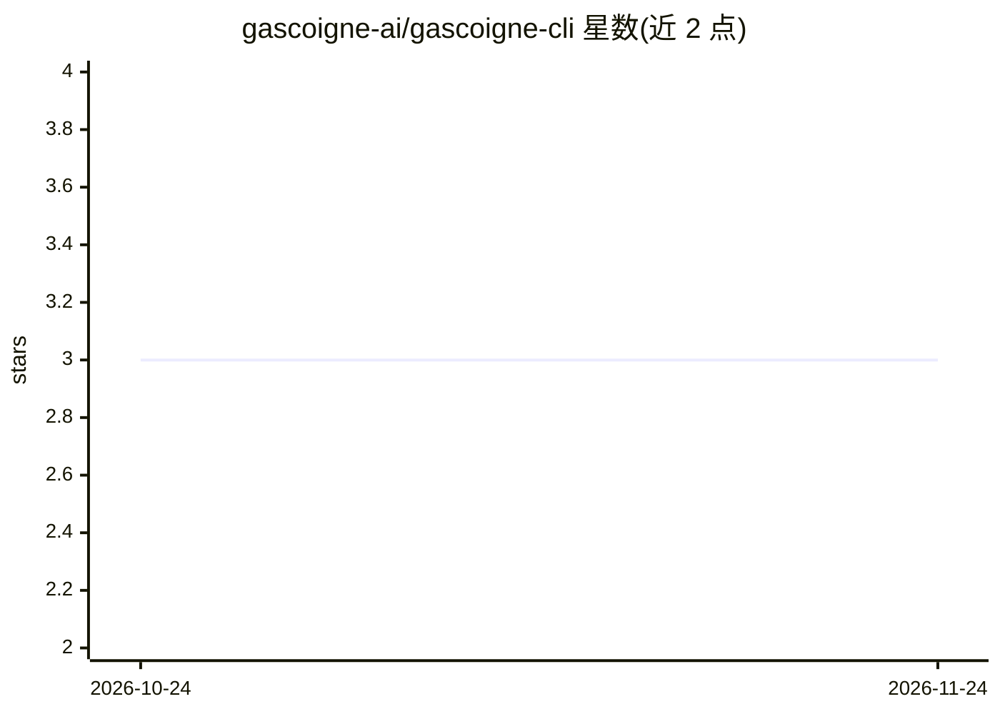

# gascoigne-ai/gascoigne-cli

⭐ 3 · Go · Apache-2.0 · 推送 2026-11-23 · [GitHub](https://github.com/gascoigne-ai/gascoigne-cli) · [官网](https://gascoigne-ai.github.io/) · 组织维护

**为编码 agent 压缩命令输出与工具结果的 token 优化 CLI**

以 Go 编写的单二进制 CLI：在命令输出、MCP 工具结果和网页进入模型前进行按族类（测试/构建/日志/k8s 等 16 族、150+ 工具格式）的压缩，保留关键事实并通过本地 sqlite 台账支持按 id 逐字节取回原文；同一输入输出确定，保持 prompt 缓存有效。通过 wrap/install 接入 Claude Code、Codex、Gemini CLI、opencode、pi、Cursor，另提供 exec/run、raw 检索、gain 与 dashboard 查看节省。 Apache-2.0。

## 筛选速览

| 维度 | 判定 | 备注 |
|---|---|---|
| AI 角色 | `ai-ecosystem` | LLM/agent 周边工具 |
| 许可风险 | `permissive` | Apache-2.0 |
| 部署形态 | `library` | 以包/库形式分发 |
| 模型依赖 | — | README 未给出锁定关系 |
| 硬件要求 | — | 无带数字的原话,不猜 |
| 安装摩擦 | `low` | 无编译、无系统依赖或容器化 |
| 成熟度 | — | 结构信号不足 |

## 能力要点

- 压缩前存原始输出到本地 sqlite 台账，raw 命令逐字节取回
- 16 个输出族类引擎，覆盖 go/git/kubectl/terraform/aws 等工具
- 通过 mcp-proxy 缩短 MCP 服务器工具结果，支持 LLM 代理路由
- 确定性输出与止损规则：节省低于提示成本则原样通过

## 适用场景

- 编码 agent 长会话中减少上下文占用与 compaction
- 降低每次请求的输入 token 账单
- 本地审计 agent 实际读到的内容与原始输出差异

## 场景标签

`编码 Agent` · 领域:编码与开发

## 证据(README 行号)

> L5: Your coding agent pays for every line a command prints, on every turn that follows. gascoigne
> L104: |Agent|Try it for one run|Keep it on|
> L135: Output is detected as `family/dialect` and handled by one engine per family: **test**, **build**,

## 星数曲线

2026-10-24 3 → 2026-11-24 3（+0）

---
*卡片 v1 · prompt 1.4 · 生成 2026-11-22 · 置信度 mid · 依据 README sha `e51315af30e4` · [字段定义](../../DATASET.md)*
