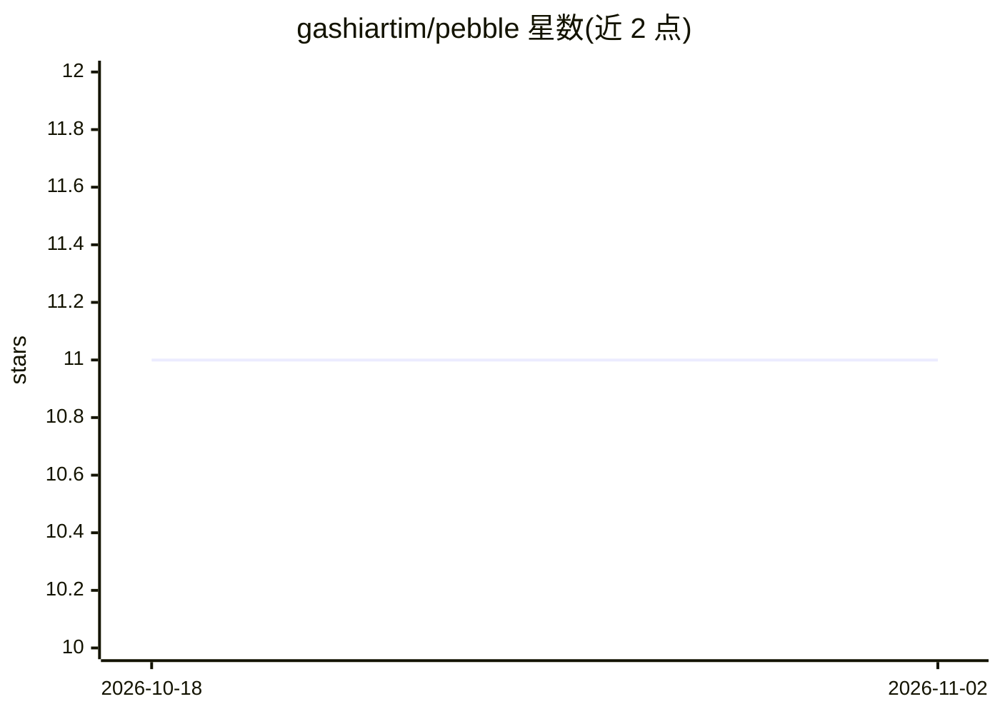

# gashiartim/pebble

⭐ 11 · TypeScript · MIT · 推送 2026-04-29 · [GitHub](https://github.com/gashiartim/pebble) · [官网](https://github.com/gashiartim/pebble) · 个人维护

**菜单栏剪贴板文本润色工具：本地 Ollama 重写剪贴板文本**

基于 Electron + React 的 macOS 菜单栏应用（支持 Windows/Linux）：全局快捷键 Cmd+Alt+P 触发，将剪贴板文本发送给本地 Ollama 模型（默认 qwen3-coder:30b）按预设重写——润色、精简、正式化、改错字、转列表、增强提示词，结果替换剪贴板供 Cmd+V 粘贴。仅连接 127.0.0.1 的 Ollama，无云端、无账号、无遥测。从源码安装需 Node.js 20+ 与本地运行的 Ollama，可构建 dmg/exe/AppImage 发行包，macOS 安装包未签名需手动 codesign。

## 筛选速览

| 维度 | 判定 | 备注 |
|---|---|---|
| AI 角色 | `ai-native` | 本体是模型或模型工具 |
| 许可风险 | `permissive` | MIT |
| 部署形态 | `desktop` | 安装包/桌面程序 |
| 模型依赖 | local-ok | 支持本地模型 |
| 硬件要求 | — | 无带数字的原话,不猜 |
| 安装摩擦 | `low` | 无编译、无系统依赖或容器化 |
| 成熟度 | — | 结构信号不足 |

## 能力要点

- 7 种润色预设，全局快捷键在任意应用中触发
- 仅连接本地 Ollama（127.0.0.1），无云端回退
- 菜单栏驻留、无 dock 图标、失焦自动隐藏
- 约 600 行 TypeScript，新增预设仅需追加数组条目

## 适用场景

- 写邮件或消息前快速润色、精简或调整语气
- 将文本改写为要点列表
- 发送给 LLM 前用 Prompt enhance 预设增强模糊提示词

## 场景标签

`AI 写作` `提示工程` · 领域:Agent 开发

## 证据(README 行号)

> L3: > Menu-bar text-polish tool that rewrites your clipboard with a local Ollama model. One global shortcut, seven prese
> L10: Pebble lives in your menu bar. Press **Cmd+Alt+P** anywhere on your machine and whatever's on your clipboard gets r
> L18: - 🔒 **100% local** — talks only to Ollama on `127.0.0.1`. No cloud fallback.

## 星数曲线

2026-10-18 11 → 2026-11-02 11（+0）

---
*卡片 v1 · prompt 1.4 · 生成 2026-11-02 · 置信度 mid · 依据 README sha `0e5f3930af0d` · [字段定义](../../DATASET.md)*
