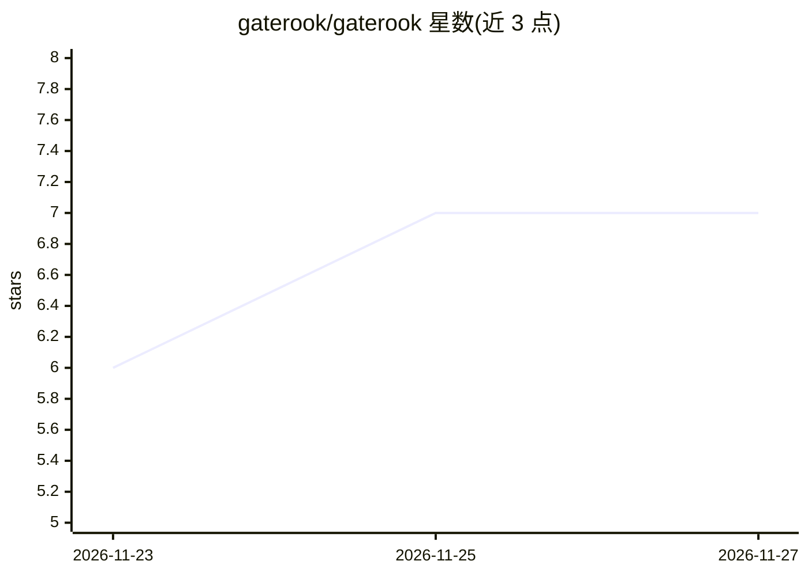

# gaterook/gaterook

⭐ 7 · Java · Apache-2.0 · 推送 2026-11-25 · [GitHub](https://github.com/gaterook/gaterook) · [官网](https://gaterook.com) · 组织维护

**给 AI 应用接入生产基础设施加权限、审批与审计的 MCP 桌面网关**

GateRook 是一款桌面应用，在 AI 应用（Claude Desktop、Codex、Cursor、Antigravity、VS Code 等 MCP 客户端）与数据库、日志、云服务、HTTP API 及外部 MCP 服务器之间充当防火墙层：以端点为单位配置作用域权限，凭据存于本地加密保险库（AES-256-GCM），变更类操作默认需人工审批，审批绑定已准备的载荷并在执行前复核完整性，请求与决策记录到 append-only 审计日志。macOS 提供 Apple Silicon 安装包，Windows 经 Microsoft Store 分发，亦可从源码构建。

## 筛选速览

| 维度 | 判定 | 备注 |
|---|---|---|
| AI 角色 | `ai-ecosystem` | LLM/agent 周边工具 |
| 许可风险 | `permissive` | Apache-2.0 |
| 部署形态 | `desktop` | 安装包/桌面程序 |
| 模型依赖 | — | README 未给出锁定关系 |
| 硬件要求 | — | 无带数字的原话,不猜 |
| 安装摩擦 | `medium` | 含编译或系统依赖之一 |
| 成熟度 | — | 结构信号不足 |

## 能力要点

- 工具级四种模式（Off/Read only/Approval/Bypass）与按端点的读写控制
- 精确动作审批：批准绑定已准备载荷，AI 客户端无法替换命令
- 内置连接器覆盖 SQL/NoSQL/数仓/向量库/日志/云基础设施等类别
- 端点工具列表超限时以 find_tools/call_tool 按需调用其余工具

## 适用场景

- 让 AI 应用排查线上事故，同时只开放只读调查权限
- 对 AI 生成的 SQL、API 请求、命令逐条审批后再执行
- 统一管理多个 AI 客户端对不同环境（DEV/STAGE/PROD）的访问
- 把已有 MCP 服务器纳入同一套权限、审批与审计

## 场景标签

 · 领域:开发者工具/基础设施安全

## 证据(README 行号)

> L5: Let AI investigate incidents, query databases, search logs, and work with your services while you control what it ca
> L7: **Works with Claude Desktop · Codex · Cursor · Antigravity · VS Code**

## 星数曲线

2026-11-23 6 → 2026-11-27 7（+1）

---
*卡片 v1 · prompt 1.4 · 生成 2026-11-23 · 置信度 high · 依据 README sha `35406f5e92c1` · [字段定义](../../DATASET.md)*
