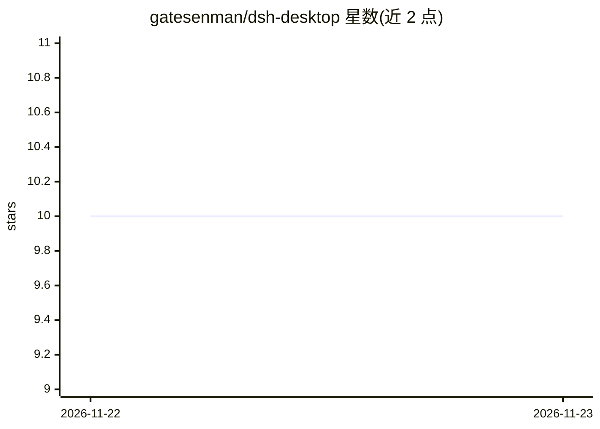

# gatesenman/dsh-desktop

⭐ 10 · JavaScript · MIT · 推送 2026-11-21 · [GitHub](https://github.com/gatesenman/dsh-desktop) · 个人维护 · 中文 README

**DeepSeek Harness (dsh) 的非官方桌面客户端，免命令行一键启动**

将官方 npm 包 @deepseek-ai/dsh 打包为 macOS/Windows/Linux 桌面应用，自动配置 Node.js 运行时并内嵌官方 dsh Web UI，不改官方源码与 Agent 体系。桌面壳提供全局快捷键快速任务、后台 Agent 收件箱、定时任务、版本钉扎与回滚、备份恢复、诊断报告、托盘常驻等外围功能。后台任务需在 Models 页面配置模型 API 凭据。通过 Releases 安装包分发，内置 Node.js 支持离线首次安装。

## 筛选速览

| 维度 | 判定 | 备注 |
|---|---|---|
| AI 角色 | `ai-ecosystem` | LLM/agent 周边工具 |
| 许可风险 | `permissive` | MIT |
| 部署形态 | `desktop` | 安装包/桌面程序 |
| 模型依赖 | locked-api |  |
| 硬件要求 | — | 无带数字的原话,不猜 |
| 安装摩擦 | `low` | 无编译、无系统依赖或容器化 |
| 成熟度 | — | 结构信号不足 |

## 能力要点

- 首启自动检测/下载 Node.js 并安装 @deepseek-ai/dsh，无需命令行
- 全局快捷键快速任务经 dsh headless 模式后台运行，带系统通知与收件箱
- dsh 版本钉扎、升级预检、失败自动回滚
- 一键备份/恢复数据目录与环境体检诊断报告

## 适用场景

- 不想配置 Node.js/命令行却要使用 dsh 的用户
- 定时执行每日任务（如总结工作目录变化）
- 需要版本回滚与数据备份保障的桌面运维场景

## 场景标签

`编码 Agent` · 领域:编码与开发

## 证据(README 行号)

> L13: DSH Desktop 将官方发布的 `@deepseek-ai/dsh` 打包为开箱即用的桌面应用：**无需命令行、无需自行安装 Node.js**，下载安装包双击打开，应用自动完成全部环境配置并直接进入界面。
> L15: > **技术说明**：应用通过 npm 安装官方公开发布的 `@deepseek-ai/dsh`（官方使用方式为 `npx @deepseek-ai/dsh web`），使用 Electron + electron-builder
> L42: - 后台任务需要已配置模型 API 凭据（在内嵌 Web UI 的 Models 页面配置即可）。

## 星数曲线

2026-11-22 10 → 2026-11-23 10（+0）

---
*卡片 v1 · prompt 1.4 · 生成 2026-11-22 · 置信度 mid · 依据 README sha `542a478d9b08` · [字段定义](../../DATASET.md)*
