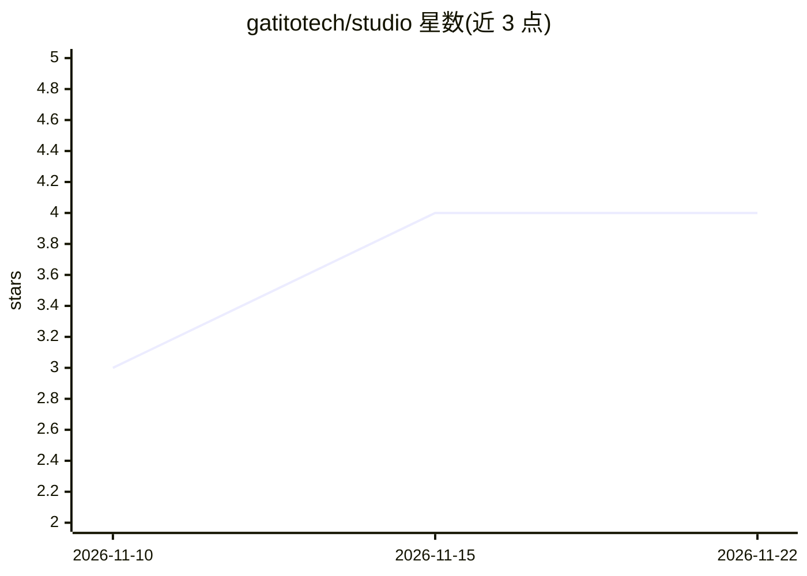

# gatitotech/studio

⭐ 4 · JavaScript · GPL-3.0 · 推送 2026-11-20 · [GitHub](https://github.com/gatitotech/studio) · 组织维护

**面向开发者的全屏终端编码 agent 客户端**

从 shell 运行的全屏终端编码 agent 客户端，提供任务路由、计划模式与面向实际工作流的 composer。工具使用覆盖读取/搜索代码、编辑文件、运行命令、网页搜索、安装 MCP 工具、加载插件与维护任务列表；支持在运行时输入指令注入到安全工具边界之后、默认隐藏推理内容、长时任务（dev server/watcher/测试）不设虚假超时。客户端不含托管推理服务或服务端控制面，需 Gatita 账号访问托管 API；fork 可修改客户端但不保证获得托管 API 访问。

## 筛选速览

| 维度 | 判定 | 备注 |
|---|---|---|
| AI 角色 | `ai-native` | 本体是模型或模型工具 |
| 许可风险 | `viral` | GPL-3.0 |
| 部署形态 | `library` | 以包/库形式分发 |
| 模型依赖 | — | README 未给出锁定关系 |
| 硬件要求 | — | 无带数字的原话,不猜 |
| 安装摩擦 | `low` | 无编译、无系统依赖或容器化 |
| 成熟度 | — | 结构信号不足 |

## 能力要点

- 全屏终端 UI：响应式布局、鼠标选择、键盘优先导航
- 终端内工具使用：读写代码、运行命令、搜索网页、安装 MCP 工具、加载插件
- 计划模式：先提问澄清并生成实现计划，经批准后才修改项目
- 长时任务支持：启动 dev server、watcher、测试与长构建

## 适用场景

- 在终端里通过对话 agent 完成代码修改与命令执行
- 先审阅实现计划再让 agent 动手改项目
- 让 agent 启动并跟踪 dev server、watcher、测试等长时任务

## 场景标签

`编码 Agent` · 领域:编码与开发

## 证据(README 行号)

> L5:  A full-screen terminal coding agent you run from your shell.
> L15: Gatita Studio is the open-source **client** for Gatita Studio. It gives your terminal an interactive, tool-using co
> L17: This repository is the client. It does **not** include a hosted inference service or the server-side control plane.

## 星数曲线

2026-11-10 3 → 2026-11-22 4（+1）

---
*卡片 v1 · prompt 1.4 · 生成 2026-11-21 · 置信度 high · 依据 README sha `65db6f51dbc4` · [字段定义](../../DATASET.md)*
