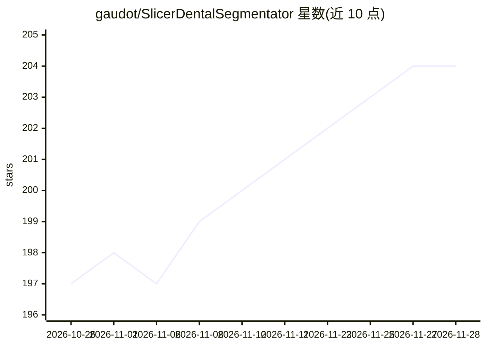

# gaudot/SlicerDentalSegmentator

⭐ 204 · Python · NOASSERTION · 推送 2026-11-24 · [GitHub](https://github.com/gaudot/SlicerDentalSegmentator) · 组织维护

**3D Slicer 扩展：自动分割颅颌面 CT/CBCT 牙科结构**

面向 3D Slicer 的开源深度学习扩展，基于 nnU-Net 框架，对颅颌面部 CT 与 CBCT 扫描自动完成五类多类别分割：上颌骨与上颅骨、下颌骨、上下牙列、下颌管。面向牙科与颅面影像的临床及科研用户。通过 Extension Manager 安装，首次运行自动下载模型权重与 PyTorch、PyTorch Lightning、nnU-Net v2 等依赖；支持 CUDA 加速推理，CPU 回退时处理时间更长。另可通过 nnU-Net 命令行脱离图形界面使用，模型权重发布于 GitHub Releases 与 Zenodo。

## 筛选速览

| 维度 | 判定 | 备注 |
|---|---|---|
| AI 角色 | `ai-native` | 本体是模型或模型工具 |
| 许可风险 | `none` | NOASSERTION |
| 部署形态 | `desktop` | 安装包/桌面程序 |
| 模型依赖 | — | README 未给出锁定关系 |
| 硬件要求 | — | 无带数字的原话,不猜 |
| 安装摩擦 | `medium` | 含编译或系统依赖之一 |
| 成熟度 | — | 结构信号不足 |

## 能力要点

- 单次运行生成 5 类解剖结构分割（上颌骨、下颌骨、上下牙列、下颌管）
- 基于 nnU-Net v2，训练数据 470 例、独立评估 256 例（7 家机构）
- 通过 3D Slicer Extension Manager 安装，依赖自动安装
- 支持 CUDA GPU 加速，并提供 nnU-Net 命令行独立使用方式

## 适用场景

- 对牙科 CT/CBCT 自动生成牙齿与下颌管等结构的三维分割
- 分割结果导入 Segment Editor 精修后导出用于科研分析
- 利用样例数据在不导入自有影像的情况下试用分割流程

## 场景标签

`科研工具` `目标检测` · 领域:学习与行业

## 证据(README 行号)

> L3: **Fully automatic AI-powered segmentation of Head and Dental CT and CBCT images in 3D Slicer.**
> L30: DentalSegmentator is based on the **nnU-Net framework**, a self-configuring deep learning framework for biomedical 
> L95: Click `Apply` to launch the automatic segmentation.

## 星数曲线

2026-10-26 197 → 2026-11-28 204（+7）

---
*卡片 v1 · prompt 1.4 · 生成 2026-11-26 · 置信度 high · 依据 README sha `ef544538dad5` · [字段定义](../../DATASET.md)*
