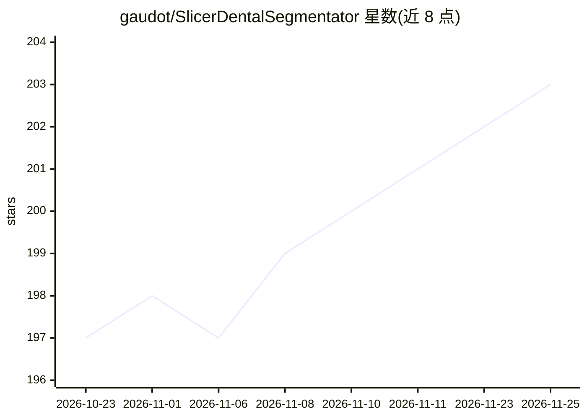

# gaudot/SlicerDentalSegmentator

⭐ 203 · Python · NOASSERTION · 推送 2026-11-18 · [GitHub](https://github.com/gaudot/SlicerDentalSegmentator) · 个人维护

**牙科 CT/CBCT 全自动多类分割的 3D Slicer 扩展**

基于 nnU-Net 框架的 3D Slicer 扩展，从单个体积自动生成上颌骨与上颅骨、下颌骨、上下牙列、下颌管五类分割，覆盖颌面 CT 与 CBCT 扫描。训练数据为 470 例扫描，独立评估 256 例、来自 7 家机构。扩展通过 3D Slicer Extension Manager 安装，首次启动自动下载模型权重与 PyTorch/nnU-Net v2 依赖；结果可在 Segment Editor 中细化、平滑并导出，另提供独立于图形界面的 nnU-Net 命令行用法。macOS Apple Silicon 暂不支持 GPU 加速。

## 筛选速览

| 维度 | 判定 | 备注 |
|---|---|---|
| AI 角色 | `ai-native` | 本体是模型或模型工具 |
| 许可风险 | `none` | NOASSERTION |
| 部署形态 | `desktop` | 安装包/桌面程序 |
| 模型依赖 | — | README 未给出锁定关系 |
| 硬件要求 | — | 无带数字的原话,不猜 |
| 安装摩擦 | `medium` | 含编译或系统依赖之一 |
| 成熟度 | — | 结构信号不足 |

## 能力要点

- 单次运行生成五类颌面解剖结构分割
- 基于 nnU-Net v2，470 例 CT/CBCT 训练、7 机构 256 例独立评估
- 通过 3D Slicer Extension Manager 一键安装，首启自动下载权重与依赖
- 支持 CUDA GPU 加速推理与 CPU 回退，并提供命令行独立运行

## 适用场景

- 对牙科 CBCT/CT 批量执行牙齿与下颌管自动分割
- 在 3D Slicer 中细化并导出颌面三维模型用于研究分析
- 配合正畸、牙移植等临床研究做牙科影像量化

## 场景标签

`目标检测` · 领域:感知与多模态

## 证据(README 行号)

> L3: **Fully automatic AI-powered segmentation of Head and Dental CT and CBCT images in 3D Slicer.**
> L5: DentalSegmentator is an open-source deep learning extension for **automatic multiclass segmentation of dento-maxillo
> L95: Click `Apply` to launch the automatic segmentation.

## 星数曲线

2026-10-23 197 → 2026-11-25 203（+6）

---
*卡片 v1 · prompt 1.4 · 生成 2026-11-25 · 置信度 high · 依据 README sha `873a7328be40` · [字段定义](../../DATASET.md)*
